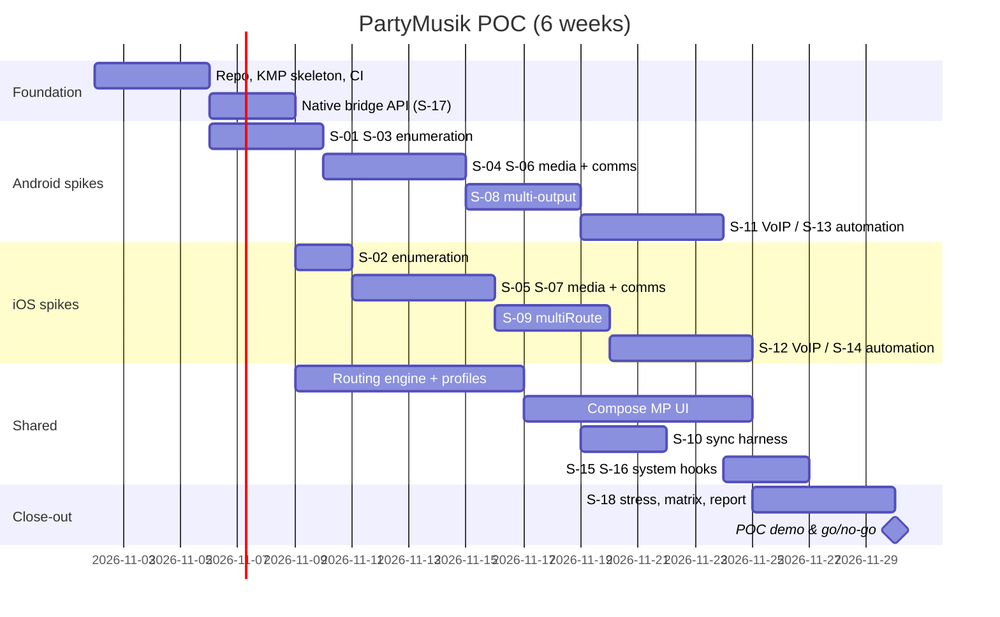

# Proof of Concept (POC) Plan

**Project codename:** PartyMusik
**Document owner:** Engineering
**Status:** Draft v0.1 — 2026-10-27
**Related:** [SRS](00-srs.md) · [System architecture](02-system-architecture.md) · [Feasibility report](09-feasibility-report.md)

---

## 1. Purpose

The POC answers one question before full product development starts:

> **Can we build a single app, with a shared cross-platform UI and shared business logic, that drives native Android and iOS audio-routing APIs to (a) route app-owned media to a chosen output, (b) route app-owned VoIP audio to a separate output, (c) fan media out to multiple outputs at once, and (d) report requested vs. available vs. active routes truthfully?**

The POC is built "full ambition first": every feature in the SRS is designed and spiked. Platform and accessory constraints are captured as *findings* during the spikes, not as up-front blockers. The output of the POC feeds the [feasibility report](09-feasibility-report.md) and the [compatibility matrix](11-compatibility-matrix.md).

## 2. Goals

| # | Goal | SRS coverage | Exit evidence |
|---|------|--------------|---------------|
| G1 | Enumerate every audio output the OS exposes and stream live changes into a shared model | DEV-001..008, MED-004 | Device list updates < 500 ms after connect/disconnect on both OSes |
| G2 | Route app-owned media to a user-selected output and confirm it | MED-001, MED-003, RTE-001, RTE-004, RTE-008 | Active route read back from OS matches selection |
| G3 | Route app-owned VoIP audio to a separate communication device | RTE-002, RTE-003, VOIP-001..006 | Media on device A while call audio on device B (where hardware allows), confirmed via OS state |
| G4 | Play the same media on N outputs simultaneously and measure skew | MED-002, MED-007, MED-008 | Skew report (ms) per output pair; per-device volume where exposed |
| G5 | Fallback and recovery when an output disappears | MED-005, MED-006, CFG-004, NFR-001 | 200 connect/disconnect cycles, 0 crashes, fallback applied |
| G6 | Profiles + automation (manual and connection-triggered) | CFG-001..008 | Profile applied automatically when a known device connects |
| G7 | Diagnostics: requested / available / active shown separately, compatibility self-test | DIA-001..007 | Diagnostics screen + exportable redacted report |
| G8 | Shared UI runs on both OSes over the native routing layer | Deliverable 3 | Same Compose Multiplatform screens on Android and iOS |
| G9 | System-level hooks for third-party audio and cellular calls | EXT-002, EXT-004, CALL-001, CALL-003 | Launch system output switcher / route picker; observe call state |

## 3. Scope

### In scope for the POC
- Kotlin Multiplatform (KMP) shared core: domain model, routing engine, profile store, automation engine, diagnostics.
- Compose Multiplatform UI (Android host Activity, iOS SwiftUI host).
- Android native adapters: `AudioManager`, `AudioDeviceCallback`, `setCommunicationDevice()`, Media3 ExoPlayer with `setPreferredAudioDevice()`, multi-`AudioTrack` fan-out, Jetpack Core-Telecom for VoIP, `CompanionDeviceManager` for pairing & presence, `MediaRouter2` system output switcher.
- iOS native adapters (Swift): `AVAudioSession` (all categories incl. `.multiRoute`), `AVAudioEngine` with channel mapping, `AVRoutePickerView`, CallKit + VoIP audio engine, `CXCallObserver`, AccessorySetupKit, App Intents for Shortcuts automation.
- Loopback VoIP (local echo / peer-to-peer on LAN) — no backend needed to prove routing.
- Sync measurement harness (acoustic chirp + OS timestamps).
- Local persistence (Room KMP + DataStore).

### Out of scope for the POC
- Production VoIP signalling backend, accounts, cloud sync.
- Store submission, monetisation, analytics backend.
- Polished visual design (the POC uses Material 3 defaults).

## 4. Spike catalogue

Each spike is a time-boxed experiment with a hypothesis, implementation sketch and a measurable result. Code sketches live in [03-android-architecture.md](03-android-architecture.md) and [04-ios-architecture.md](04-ios-architecture.md).

| ID | Spike | Platform | Hypothesis | Measure | Box |
|----|-------|----------|-----------|---------|-----|
| S-01 | Output enumeration & live events | Android | `AudioManager.getDevices(GET_DEVICES_OUTPUTS)` + `AudioDeviceCallback` gives a complete, real-time list incl. A2DP, SCO, LE Audio, hearing aids, USB, wired | Event latency, device types seen | 2 d |
| S-02 | Output enumeration & live events | iOS | `AVAudioSession.currentRoute`, `availableInputs`, `routeChangeNotification` give a complete route picture per category | Ports seen per category | 2 d |
| S-03 | Bonded vs. audio-capable devices | Android | Cross-joining `BluetoothAdapter.bondedDevices` with A2DP/HFP/LE-Audio profile proxies explains "paired but not an audio output" (DEV-007) | Correct classification on 10 accessories | 2 d |
| S-04 | Media output selection | Android | `ExoPlayer.setPreferredAudioDevice()` routes media; `AudioManager.getAudioDevicesForAttributes()` confirms | Selection→confirmed latency | 2 d |
| S-05 | Media output selection | iOS | `AVRoutePickerView` + category/option combos select output; `currentRoute.outputs` confirms | Selection→confirmed latency | 2 d |
| S-06 | Split media/communication | Android | `setCommunicationDevice(B)` while ExoPlayer preferred device = A keeps the two separate | Both routes confirmed simultaneously | 3 d |
| S-07 | Split media/communication | iOS | `.playAndRecord` + `setPreferredInput(HFP)` + `.allowBluetoothA2DP`; evaluate dual-session strategies | Which combos hold both routes | 3 d |
| S-08 | Multi-output fan-out | Android | N `AudioTrack`s fed from one decoder, each `setPreferredDevice()` → N outputs (speaker + BT, USB + BT, BT + BT, LE Audio broadcast) | Outputs reached, skew ms | 4 d |
| S-09 | Multi-output fan-out | iOS | `.multiRoute` + `AVAudioEngine` output channel map drives multiple ports (USB/HDMI/wired + BT) | Outputs reached, skew ms | 4 d |
| S-10 | Sync measurement | Both | Chirp-based acoustic loopback + `AudioTrack.getTimestamp()` / `AVAudioTime` estimates per-output latency within ±5 ms | Measurement error | 3 d |
| S-11 | VoIP call with route switching | Android | Core-Telecom `CallsManager` + `requestEndpointChange()` switches endpoints mid-call | Switch latency, audio gap | 3 d |
| S-12 | VoIP call with route switching | iOS | CallKit + `AVAudioEngine` voice processing; route switch via preferred input / route picker | Switch latency, audio gap | 3 d |
| S-13 | Connection-triggered automation | Android | `CompanionDeviceManager.startObservingDevicePresence()` wakes `CompanionDeviceService` on connect even when app is killed | Wake reliability over 50 cycles | 2 d |
| S-14 | Connection-triggered automation | iOS | App Intent invoked by a Shortcuts "Bluetooth connected" personal automation applies a profile | Trigger reliability over 50 cycles | 2 d |
| S-15 | System-level / third-party audio hooks | Both | `MediaRouter2.showSystemOutputSwitcher()` (Android 14+) and `AVRoutePickerView` let users steer system audio; Android/iOS audio sharing (LE Audio Auracast, AirPods Share Audio) observable | Feature presence per device | 2 d |
| S-16 | Cellular call awareness | Both | Android `AudioManager.OnModeChangedListener` / Telecom call state; iOS `CXCallObserver` detect cellular calls and trigger RTE-006 restore | Detection latency | 1 d |
| S-17 | KMP ↔ Swift bridge | iOS | Kotlin `interface` ports implemented in Swift and injected into KMP core, with `Flow` → `AsyncSequence` via SKIE | Round-trip correctness, no leaks | 2 d |
| S-18 | Stress & resilience | Both | Routing engine survives 200 rapid connect/disconnect cycles with no crash and correct fallback | Crash count, state correctness | 2 d |

**Total spike effort:** ~44 engineer-days (≈ 5 weeks for 2 native engineers + 1 KMP/UI engineer working in parallel).

## 5. POC deliverables

1. **POC app (Android + iOS)** with screens: Devices, Player, Routing, Call (VoIP loopback), Profiles, Diagnostics, Permissions.
2. **Native routing modules** (`:platform-android`, `PlatformIOS` Swift package) implementing the [native bridge API](08-native-bridge-api.md).
3. **Shared KMP core** (`:shared`) with routing engine, profile store, automation and diagnostics.
4. **Sync measurement tool** and raw measurement CSVs.
5. **Feasibility report** filled in with spike results ([09-feasibility-report.md](09-feasibility-report.md)).
6. **Compatibility matrix v0** ([11-compatibility-matrix.md](11-compatibility-matrix.md)).
7. **Demo video** for each goal G1–G9.

## 6. POC timeline

## 7. Team

| Role | Count | Responsibility |
|------|-------|----------------|
| Tech lead / architect | 1 | Architecture, bridge API, routing engine, go/no-go |
| Android audio engineer | 1 | S-01, S-03, S-04, S-06, S-08, S-11, S-13 |
| iOS audio engineer | 1 | S-02, S-05, S-07, S-09, S-12, S-14, S-17 |
| KMP / UI engineer | 1 | Shared core, Compose MP UI, persistence |
| QA (physical devices) | 0.5 | Device lab, stress runs, matrix |

## 8. Device lab for the POC

| Category | Devices |
|----------|---------|
| Android phones | Pixel 9 / 10 (Android 16), Samsung Galaxy S25 (One UI 8), OnePlus 13, one Android 12 device (API 31 baseline) |
| iPhones | iPhone 16 / 17 (iOS 26), iPhone 13 (iOS 18 baseline) |
| Classic BT headphones | Sony WH-1000XM5, Bose QC Ultra |
| True-wireless earbuds | AirPods Pro 2, Galaxy Buds3 Pro (LE Audio), Pixel Buds Pro 2 |
| BT speakers | JBL Flip 6 / Charge 5 (PartyBoost), UE Boom 4 |
| LE Audio / Auracast | Galaxy Buds3 Pro, JBL Charge 6 / Flip 7 (Auracast) |
| Car kit / HFP-only | Generic HFP car adapter |
| Wired / USB | USB-C DAC, USB-C headset, 3.5 mm via adapter |
| Hearing aid (ASHA / MFi) | One ASHA-capable, one MFi-capable unit |

## 9. Success criteria / go–no-go

| Criterion | Go threshold |
|-----------|--------------|
| G1–G2 work on both OSes | Required |
| G3 split routing confirmed on ≥ 1 accessory combination per OS | Required |
| G4 multi-output on ≥ 2 configurations per OS, skew measured | Required (skew value itself is a finding, not a gate) |
| G5 stress run | 0 crashes in 200 cycles |
| G6 automation trigger | ≥ 95 % reliability on Android; documented behaviour on iOS |
| G8 shared UI | ≥ 80 % of UI code shared |
| Truthful state | Zero cases in test where UI shows "active" for a route the OS does not report (RTE-008) |

## 10. Risks tracked during POC

See the full register in [09-feasibility-report.md §6](09-feasibility-report.md#6-risk-register). Top items:

1. Simultaneous output to two classic-A2DP sinks from one phone (S-08) — the spike defines which combinations the product declares.
2. iOS split media/communication routing (S-07) — category arbitration may force a single route.
3. Bluetooth latency variance makes multi-output sync noticeable (S-10) — mitigation is per-output delay compensation.
4. Background automation on iOS (S-14) relies on user-configured Shortcuts.
5. KMP ↔ Swift interop overhead (S-17).

## 11. After the POC

1. Fill in [09-feasibility-report.md](09-feasibility-report.md) and freeze NFR-008 supported OS versions.
2. Publish [11-compatibility-matrix.md](11-compatibility-matrix.md) v1.
3. Convert spikes into production modules following [02-system-architecture.md](02-system-architecture.md).
4. Execute the full [test strategy](10-test-strategy.md).
5. Release pipeline per [14-build-and-deployment.md](14-build-and-deployment.md).
