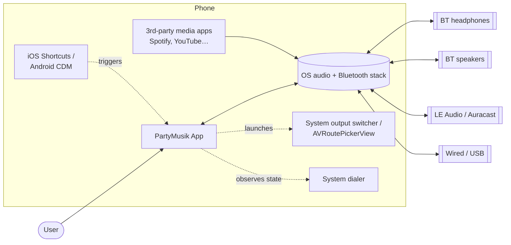
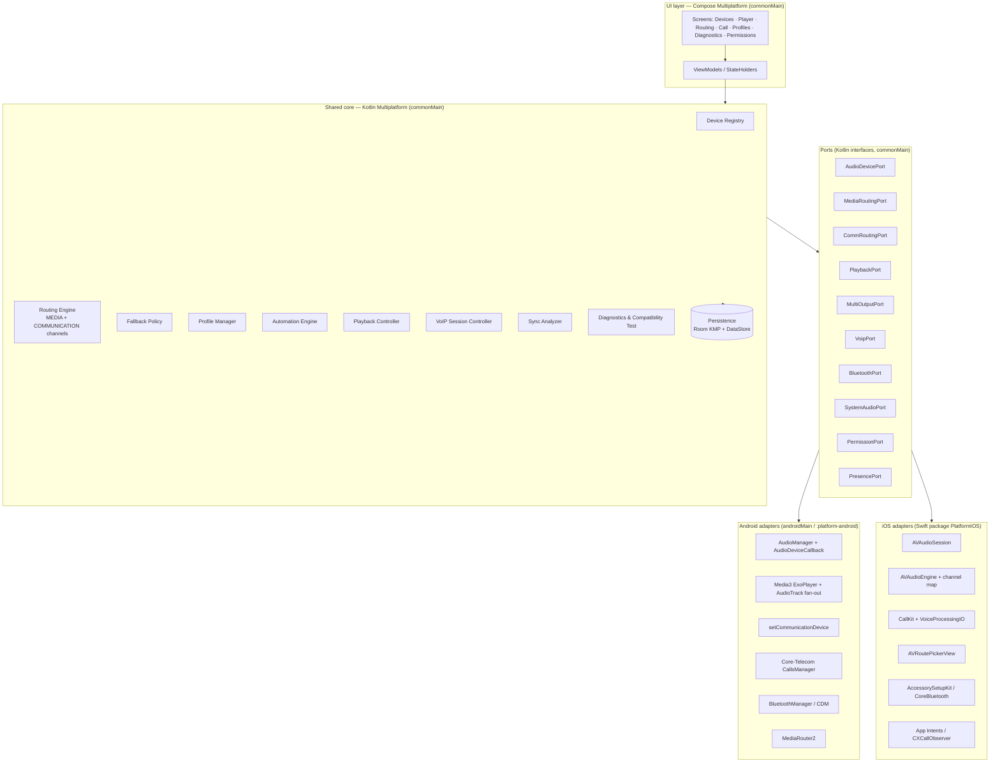
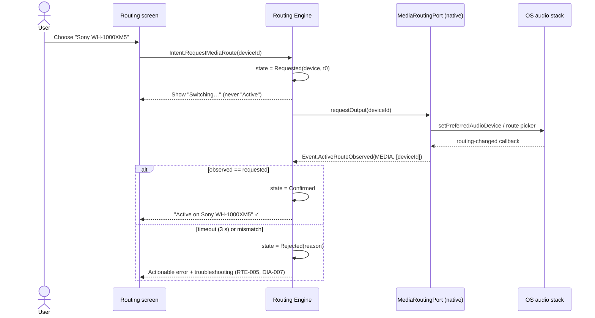
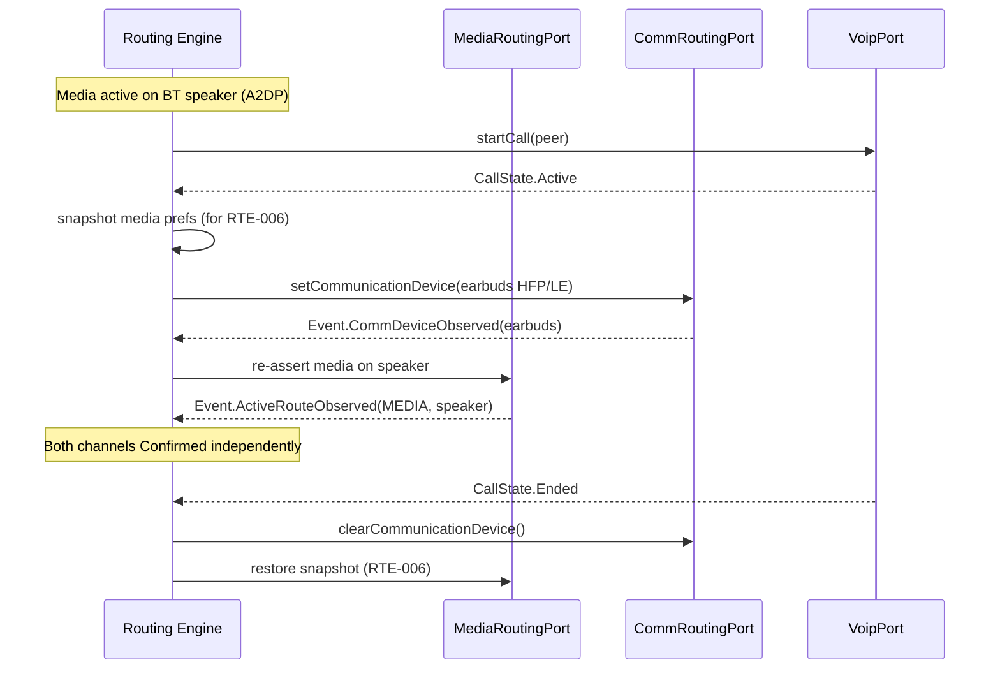
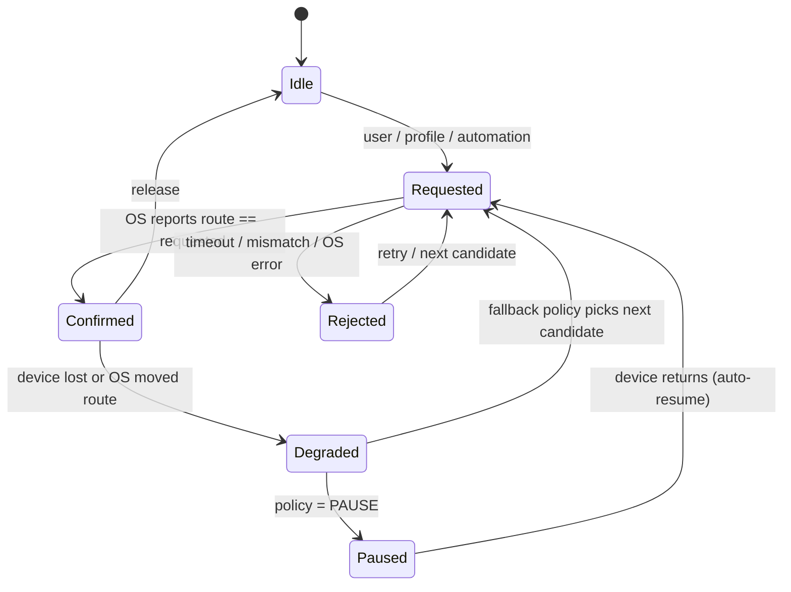
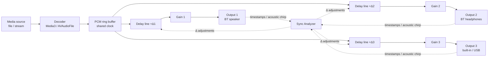

# System Architecture

**Status:** Draft v0.1 — 2026-10-27
**Related:** [Android](03-android-architecture.md) · [iOS](04-ios-architecture.md) · [Shared core & UI](05-shared-core-and-ui.md) · [Routing engine](06-routing-engine.md) · [Bridge API](08-native-bridge-api.md) · [ADRs](adr/)

---

## 1. Architectural drivers

| Driver | Source | Architectural response |
|--------|--------|------------------------|
| One UI, two native audio stacks | SRS header, Deliverable 3 & 4 | Kotlin Multiplatform shared core + Compose Multiplatform UI; native audio adapters per OS behind ports ([ADR-001](adr/ADR-001-cross-platform-stack.md)) |
| Truthful route status | RTE-004, RTE-008, NFR-002, DIA-001 | Three-state route model: **Requested → Available → Active**, where *Active* is only ever written by OS observation ([ADR-003](adr/ADR-003-route-confirmation-model.md)) |
| Separate media and communication routing | RTE-003, VOIP-006 | Two independent routing *channels* (`MEDIA`, `COMMUNICATION`) each with its own state machine |
| Multi-output playback | MED-002, MED-007 | Fan-out audio pipeline with per-output delay compensation and sync measurement |
| Resilience under churn | MED-005, NFR-001 | Event-sourced device registry, single-threaded engine actor, idempotent native commands |
| Offline, private, local | NFR-005, NFR-006, DIA-003 | Local encrypted persistence, no backend, redacted diagnostics ([ADR-002](adr/ADR-002-local-persistence.md)) |
| Background automation | CFG-006, NFR-004 | Event-driven triggers via OS presence APIs only; no polling ([ADR-004](adr/ADR-004-automation-triggers.md)) |

## 2. Context view (C4 level 1)



## 3. Container view (C4 level 2)



## 4. Layering rules

1. **UI** depends only on **Core** (StateFlows + intents). UI never calls a port directly.
2. **Core** depends only on **Ports** (interfaces) and the persistence abstraction. No `android.*` or `platform.AVFAudio.*` imports in `commonMain`.
3. **Adapters** implement ports, translate OS callbacks into domain events, and never hold business rules (no fallback logic, no profile logic).
4. **Adapters are the only writers of `ActiveRoute`.** Core may write `RequestedRoute`; only an adapter observation can promote a route to `Active` (RTE-008).
5. All native callbacks are marshalled onto the **Routing Engine actor** (single coroutine, `Dispatchers.Default.limitedParallelism(1)`), giving a total order of events and eliminating races during rapid connect/disconnect (NFR-001).

## 5. Key runtime flows

### 5.1 Select a media output (RTE-001, RTE-004, RTE-008)



### 5.2 Split media + VoIP routing (RTE-003, VOIP-002, VOIP-006)



### 5.3 Output disconnect + fallback (MED-005, MED-006, CFG-004)



Full semantics in [06-routing-engine.md](06-routing-engine.md).

### 5.4 Multi-output playback (MED-002, MED-007, MED-008)



- Android: one decoder, N `AudioTrack` sinks, each bound with `setPreferredDevice()`.
- iOS: `AVAudioEngine` in `.multiRoute` session; output node channel map assigns channel pairs to ports.
- The Sync Analyzer computes per-output latency and writes delay offsets so all outputs align to the slowest one.
- An OS-level path (LE Audio broadcast / Auracast sink, vendor party modes) is modelled as a single *broadcast output* with N receivers.

## 6. Module structure

```
partymusik/
├── shared/                         # KMP module
│   ├── src/commonMain/kotlin/
│   │   ├── domain/                 # AudioEndpoint, RouteState, Profile, …
│   │   ├── engine/                 # RoutingEngine, FallbackPolicy, channels
│   │   ├── playback/               # PlaybackController, MultiOutputMixer model
│   │   ├── voip/                   # VoipSessionController
│   │   ├── automation/             # AutomationEngine, triggers
│   │   ├── diagnostics/            # DiagnosticsLog, CompatibilityTest, redaction
│   │   ├── sync/                   # SyncAnalyzer (chirp correlation)
│   │   ├── ports/                  # Port interfaces (bridge API)
│   │   └── data/                   # Room KMP DAOs, DataStore prefs
│   ├── src/androidMain/kotlin/     # Android port implementations
│   └── src/iosMain/kotlin/         # iOS glue (Swift impls injected)
├── composeApp/                     # Compose Multiplatform UI
│   ├── src/commonMain/             # Screens, theme, navigation
│   ├── src/androidMain/            # MainActivity, services, manifest
│   └── src/iosMain/                # MainViewController()
├── iosApp/                         # Xcode project (SwiftUI host)
│   ├── iosApp/                     # App, SceneDelegate, Info.plist
│   └── PlatformIOS/                # Swift package: AVAudioSession, CallKit adapters
├── tools/sync-harness/             # Chirp generator + offline analysis
└── docs/                           # ← you are here
```

## 7. Cross-cutting concerns

| Concern | Approach |
|---------|----------|
| Concurrency | Engine actor; ports expose `Flow` (Android) / bridged `Flow` from Swift `AsyncStream` (iOS) |
| Error model | Sealed `RouteError` with stable codes (`RTE_TIMEOUT`, `RTE_DEVICE_GONE`, `RTE_OS_REJECTED`, `RTE_UNSUPPORTED_COMBO`, `PERM_DENIED`, `BT_OFF`, …) mapped to user text + troubleshooting article |
| Logging | Structured diagnostics events with codes only; device MAC addresses hashed; no audio buffers ([12-security-privacy.md](12-security-privacy.md)) |
| Accessibility | Every route chip has `contentDescription` with *state* ("Sony headphones, requested, not yet active") — NFR-007 |
| Battery | No polling; OS callbacks only; foreground service only while playing / in call; presence observation delegated to OS (NFR-004) |
| Configuration | Feature flags per capability, auto-set by Compatibility Test results |
| Localisation | All user strings in Compose resources (`composeResources/values*/strings.xml`) |

## 8. Capability model

Every endpoint carries a capability set computed by the adapter, so the UI and engine never hard-code platform rules:

```kotlin
enum class Capability {
    MEDIA_OUTPUT,          // can carry app media
    COMMUNICATION_OUTPUT,  // can carry call audio (HFP/SCO, LE Audio, built-in, wired)
    MICROPHONE,            // has input
    MULTI_OUTPUT_MEMBER,   // can be one of N in fan-out
    BROADCAST_SINK,        // LE Audio broadcast / Auracast receiver
    INDEPENDENT_VOLUME,    // per-device volume controllable (MED-008)
    ABSOLUTE_VOLUME,       // BT absolute volume
    LOW_LATENCY,           // e.g. LE Audio, wired, built-in
    RECONNECTABLE,         // OS-permitted reconnect available (DEV-006)
}
```

## 9. Deployment view

- **Android:** single APK/AAB, `minSdk 31` (Android 12 — `setCommunicationDevice`, `BLUETOOTH_CONNECT`, CDM presence), `targetSdk 36`.
- **iOS:** single app, deployment target iOS 17 (AccessorySetupKit features gated to iOS 18+), Swift 6, Kotlin framework built as static XCFramework.
- No server components. Optional crash reporting is opt-in only.

Details: [14-build-and-deployment.md](14-build-and-deployment.md).
