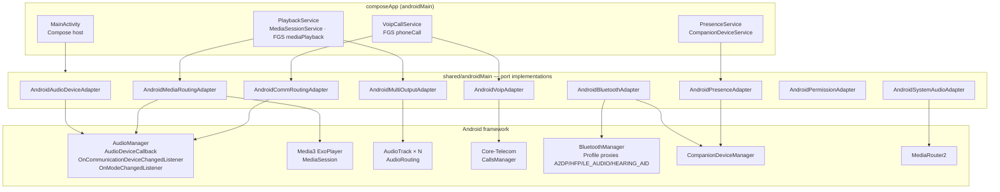

# Android Architecture & Native Routing POC

**Status:** Draft v0.1 — 2026-10-27
**Baseline:** `minSdk 31` (Android 12), `targetSdk 36` (Android 16), Kotlin 2.2, Media3 1.8+, Jetpack Core-Telecom 1.0+
**Related:** [System architecture](02-system-architecture.md) · [Bridge API](08-native-bridge-api.md) · [Routing engine](06-routing-engine.md)

---

## 1. Component map



## 2. Device enumeration & monitoring (DEV-001, DEV-002, DEV-004, S-01)

```kotlin
class AndroidAudioDeviceAdapter(
    private val context: Context,
    private val bt: AndroidBluetoothAdapter,
) : AudioDevicePort {

    private val audioManager = context.getSystemService(AudioManager::class.java)

    override val endpoints: Flow<List<AudioEndpoint>> = callbackFlow {
        fun emitSnapshot() {
            val outputs = audioManager.getDevices(AudioManager.GET_DEVICES_OUTPUTS)
            val inputs = audioManager.getDevices(AudioManager.GET_DEVICES_INPUTS)
            val comm = audioManager.availableCommunicationDevices
            trySend(outputs.map { it.toEndpoint(inputs, comm, bt.bondInfo(it.address)) })
        }
        val cb = object : AudioDeviceCallback() {
            override fun onAudioDevicesAdded(added: Array<out AudioDeviceInfo>) = emitSnapshot()
            override fun onAudioDevicesRemoved(removed: Array<out AudioDeviceInfo>) = emitSnapshot()
        }
        audioManager.registerAudioDeviceCallback(cb, Handler(Looper.getMainLooper()))
        emitSnapshot()
        awaitClose { audioManager.unregisterAudioDeviceCallback(cb) }
    }.distinctUntilChanged()
}

private fun AudioDeviceInfo.toEndpoint(...): AudioEndpoint = AudioEndpoint(
    id = EndpointId.android(id, address),
    name = productName.toString(),
    kind = when (type) {
        AudioDeviceInfo.TYPE_BLUETOOTH_A2DP -> EndpointKind.BT_CLASSIC_MEDIA
        AudioDeviceInfo.TYPE_BLUETOOTH_SCO  -> EndpointKind.BT_CLASSIC_HFP
        AudioDeviceInfo.TYPE_BLE_HEADSET,
        AudioDeviceInfo.TYPE_BLE_SPEAKER    -> EndpointKind.BT_LE_AUDIO
        AudioDeviceInfo.TYPE_BLE_BROADCAST  -> EndpointKind.BT_LE_BROADCAST
        AudioDeviceInfo.TYPE_HEARING_AID    -> EndpointKind.HEARING_AID
        AudioDeviceInfo.TYPE_WIRED_HEADPHONES,
        AudioDeviceInfo.TYPE_WIRED_HEADSET  -> EndpointKind.WIRED
        AudioDeviceInfo.TYPE_USB_DEVICE,
        AudioDeviceInfo.TYPE_USB_HEADSET    -> EndpointKind.USB
        AudioDeviceInfo.TYPE_BUILTIN_SPEAKER -> EndpointKind.BUILTIN_SPEAKER
        AudioDeviceInfo.TYPE_BUILTIN_EARPIECE -> EndpointKind.BUILTIN_EARPIECE
        AudioDeviceInfo.TYPE_HDMI           -> EndpointKind.HDMI
        else -> EndpointKind.OTHER
    },
    connection = ConnectionState.CONNECTED,
    capabilities = buildSet { /* derived from type, channel counts, sample rates, comm list */ },
    sampleRates = sampleRates.toList(),
    channelCounts = channelCounts.toList(),
)
```

### Paired-but-not-audio classification (DEV-007, S-03)

`AndroidBluetoothAdapter` opens profile proxies for `A2DP`, `HEADSET`, `LE_AUDIO`, `HEARING_AID` and listens to `ACTION_CONNECTION_STATE_CHANGED` for each. For every bonded device:

| Bonded? | Profile connected? | In `getDevices(OUTPUTS)`? | Shown as | Explanation key |
|---------|-------------------|---------------------------|----------|-----------------|
| ✔ | ✘ | ✘ | Paired · not connected | `bt_paired_not_connected` |
| ✔ | HFP only | SCO appears only in comm list | Calls only | `bt_hfp_only` |
| ✔ | A2DP | ✔ | Media output | — |
| ✔ | none (keyboard, watch, BLE sensor) | ✘ | Not an audio device | `bt_not_audio` |
| ✘ | — | ✔ (wired/USB) | Output | — |

## 3. Media routing (MED-001, MED-003, RTE-001, RTE-004, S-04)

> **POC implementation note (D1):** the POC plays app media through its own `AudioTrack` sinks (`AndroidAudioOutputEngine`) because only `AudioRouting.OnRoutingChangedListener` reports the device the OS actually used. The ExoPlayer sketch below is the original design; see [15-poc-implementation.md §5](15-poc-implementation.md#5-deviations-from-the-design-docs-decided-while-building). Without ExoPlayer, the engine requests and handles audio focus itself (RTE-007: transient loss pauses and resumes, permanent loss pauses). `PlaybackService` exposes the engine to the system through a Media3 MediaSession by wrapping `PlaybackPort` in a `SimpleBasePlayer` (D10).

App-owned media runs in a `MediaSessionService` with Media3 `ExoPlayer`:

```kotlin
class AndroidMediaRoutingAdapter(
    private val player: ExoPlayer,
    private val audioManager: AudioManager,
) : MediaRoutingPort {

    override suspend fun requestOutput(endpoint: EndpointId): RouteCommandResult {
        val device = audioManager.getDevices(AudioManager.GET_DEVICES_OUTPUTS)
            .firstOrNull { it.matches(endpoint) }
            ?: return RouteCommandResult.Rejected(RouteError.DeviceGone)
        withContext(Dispatchers.Main) { player.setPreferredAudioDevice(device) }
        return RouteCommandResult.Submitted   // NOT "Active" — confirmation comes from observedRoute
    }

    /** Ground truth for MED-004 / RTE-004 / RTE-008. */
    override val observedRoute: Flow<List<EndpointId>> = callbackFlow {
        val attrs = AudioAttributes.Builder()
            .setUsage(AudioAttributes.USAGE_MEDIA)
            .setContentType(AudioAttributes.CONTENT_TYPE_MUSIC)
            .build()
        fun emit() = trySend(audioManager.getAudioDevicesForAttributes(attrs).map { it.endpointId() })
        val cb = object : AudioDeviceCallback() {
            override fun onAudioDevicesAdded(a: Array<out AudioDeviceInfo>) = emit()
            override fun onAudioDevicesRemoved(r: Array<out AudioDeviceInfo>) = emit()
        }
        audioManager.registerAudioDeviceCallback(cb, null)
        // Also listen to the player's AudioTrack routing via AnalyticsListener.onAudioTrackInitialized / routing events
        emit()
        awaitClose { audioManager.unregisterAudioDeviceCallback(cb) }
    }
}
```

- `MED-003`: play/pause/seek/status are `MediaController` commands exposed via `PlaybackPort`.
- Audio focus (`RTE-007`): ExoPlayer `setAudioAttributes(attrs, handleAudioFocus = true)`; focus loss events forwarded to the engine as `Event.FocusChanged`.
- Becoming-noisy (headphones unplugged): `setHandleAudioBecomingNoisy(true)` + engine fallback.

## 4. Communication routing (RTE-002, RTE-003, VOIP-002, S-06)

```kotlin
class AndroidCommRoutingAdapter(private val am: AudioManager) : CommRoutingPort {

    override val available: Flow<List<EndpointId>> = /* am.availableCommunicationDevices + AudioDeviceCallback */

    override suspend fun request(endpoint: EndpointId): RouteCommandResult {
        val dev = am.availableCommunicationDevices.firstOrNull { it.matches(endpoint) }
            ?: return RouteCommandResult.Rejected(RouteError.NotACommDevice)
        return if (am.setCommunicationDevice(dev)) RouteCommandResult.Submitted
               else RouteCommandResult.Rejected(RouteError.OsRejected("setCommunicationDevice=false"))
    }

    override suspend fun release() = am.clearCommunicationDevice()

    override val observed: Flow<EndpointId?> = callbackFlow {
        val l = AudioManager.OnCommunicationDeviceChangedListener { trySend(it?.endpointId()) }
        am.addOnCommunicationDeviceChangedListener(Dispatchers.Default.asExecutor(), l)
        trySend(am.communicationDevice?.endpointId())
        awaitClose { am.removeOnCommunicationDeviceChangedListener(l) }
    }
}
```

**Split-routing experiment matrix (S-06):**

| Media preferred device | Comm device | Expected |
|------------------------|-------------|----------|
| BT speaker (A2DP) | Built-in earpiece | Both confirmed |
| BT speaker (A2DP) | Wired headset | Both confirmed |
| BT headphones A (A2DP) | BT earbuds B (HFP/LE) | Spike measures — dual-BT link behaviour per chipset |
| LE Audio earbuds (media) | Same LE earbuds (call) | Single device, both contexts |
| USB DAC | BT earbuds (HFP) | Both confirmed |

## 5. Multi-output fan-out (MED-002, MED-007, MED-008, S-08)

```kotlin
class AndroidMultiOutputAdapter(private val am: AudioManager) : MultiOutputPort {

    private val sinks = mutableMapOf<EndpointId, Sink>()

    private class Sink(val track: AudioTrack, val delay: DelayLine, var gain: Float)

    override suspend fun start(targets: List<EndpointId>, format: PcmFormat) {
        targets.forEach { id ->
            val dev = am.getDevices(AudioManager.GET_DEVICES_OUTPUTS).first { it.matches(id) }
            val track = AudioTrack.Builder()
                .setAudioAttributes(mediaAttrs)
                .setAudioFormat(format.toAudioFormat())
                .setBufferSizeInBytes(format.bufferBytes(ms = 40))
                .setTransferMode(AudioTrack.MODE_STREAM)
                .setPerformanceMode(AudioTrack.PERFORMANCE_MODE_LOW_LATENCY)
                .build()
            track.setPreferredDevice(dev)
            track.addOnRoutingChangedListener({ r -> onRouted(id, r.routedDevice) }, null)
            track.play()
            sinks[id] = Sink(track, DelayLine(format), gain = 1f)
        }
    }

    /** Called by the decoder thread with each PCM chunk. */
    fun write(chunk: ShortArray) = sinks.values.forEach { s ->
        s.track.write(s.delay.process(chunk), 0, chunk.size, AudioTrack.WRITE_NON_BLOCKING)
    }

    override fun setDelay(id: EndpointId, ms: Int) { sinks[id]?.delay?.setMs(ms) }
    override fun setGain(id: EndpointId, gain: Float) { sinks[id]?.track?.setVolume(gain) }  // MED-008

    override fun timestamps(): Map<EndpointId, PresentationTimestamp> = sinks.mapValues { (_, s) ->
        AudioTimestamp().also { s.track.getTimestamp(it) }.let { PresentationTimestamp(it.framePosition, it.nanoTime) }
    }
}
```

Configurations under test:

| # | Output set | Path |
|---|-----------|------|
| M1 | Built-in speaker + BT A2DP | 2 × AudioTrack |
| M2 | USB DAC + BT A2DP | 2 × AudioTrack |
| M3 | Wired + BT A2DP | 2 × AudioTrack |
| M4 | BT A2DP + BT A2DP (dual-sink) | 2 × AudioTrack, chipset/OEM dependent (e.g. Samsung Dual Audio) |
| M5 | LE Audio broadcast (Auracast) → N receivers | Single `TYPE_BLE_BROADCAST` output, OS audio sharing |
| M6 | Vendor party mode (JBL Auracast/PartyBoost, UE PartyUp) | Single A2DP to host speaker, speaker-to-speaker relay |

## 6. VoIP (VOIP-001..006, S-11)

Uses **Jetpack Core-Telecom** (`androidx.core:core-telecom`), which wraps a self-managed `ConnectionService` and gives endpoint control:

```kotlin
class AndroidVoipAdapter(private val context: Context) : VoipPort {
    private val calls = CallsManager(context).apply {
        registerAppWithTelecom(CallsManager.CAPABILITY_BASELINE)
    }

    override suspend fun startCall(peer: Peer, scope: CoroutineScope) {
        val attrs = CallAttributesCompat(
            displayName = peer.name, address = peer.uri,
            direction = CallAttributesCompat.DIRECTION_OUTGOING,
            callType = CallAttributesCompat.CALL_TYPE_AUDIO_CALL,
        )
        calls.addCall(attrs, onAnswer = {}, onDisconnect = { release() },
                      onSetActive = {}, onSetInactive = {}) {
            launch { availableEndpoints.collect { engine.emit(Event.CallEndpoints(it.map(::toId))) } }
            launch { currentCallEndpoint.collect { engine.emit(Event.CommDeviceObserved(toId(it))) } }
            launch { isMuted.collect { engine.emit(Event.MuteChanged(it)) } }
            commands.collect { cmd ->
                when (cmd) {
                    is VoipCmd.SwitchEndpoint -> requestEndpointChange(cmd.endpoint.toCompat())  // VOIP-004
                    VoipCmd.Hangup -> disconnect(DisconnectCause(DisconnectCause.LOCAL))         // VOIP-005
                }
            }
        }
    }
}
```

Audio I/O for the POC: `AudioRecord` (`VOICE_COMMUNICATION` source with AEC/NS) → Opus → UDP loopback / LAN peer → `AudioTrack` (`USAGE_VOICE_COMMUNICATION`). Production can swap in WebRTC.

## 7. Cellular calls (CALL-001..005, S-16)

- `AudioManager.addOnModeChangedListener` → `MODE_IN_CALL` / `MODE_CALL_SCREENING` → engine raises `Event.CellularCallStarted`, pauses media, snapshots prefs; on `MODE_NORMAL` restores (RTE-006).
- `CALL-001`: while in call, `availableCommunicationDevices` and `communicationDevice` are displayed read-only.
- `CALL-003`: in-app guide deep-links to the in-call system route button and Bluetooth settings.
- `CALL-005`: an experimental `TelecomRouteProbe` (behind feature flag) tests whether `setCommunicationDevice` affects a system call on a given device; results go to the compatibility matrix only.

## 8. Bluetooth workflows (DEV-003, DEV-006, DEV-008)

| Need | API |
|------|-----|
| Pair new accessory | `CompanionDeviceManager.associate()` with `BluetoothDeviceFilter` → system pairing sheet; fallback `Settings.ACTION_BLUETOOTH_SETTINGS` |
| Reconnect | CDM association + system Bluetooth panel (`Settings.Panel` / output switcher); no hidden `connect()` calls |
| BT disabled | `BluetoothAdapter.ACTION_REQUEST_ENABLE` intent; listen `ACTION_STATE_CHANGED` |
| Permission | `BLUETOOTH_CONNECT` (runtime), `BLUETOOTH_SCAN` with `neverForLocation` |
| Presence automation | `CompanionDeviceManager.startObservingDevicePresence()` → `PresenceService : CompanionDeviceService` (`onDeviceAppeared` / `onDevicePresenceEvent` on API 36) |

## 9. System-level & third-party audio (EXT-002, EXT-004, S-15)

- `MediaRouter2.getInstance(ctx).showSystemOutputSwitcher()` (API 34+) — lets the user move *any* app's media (including Spotify/YouTube) to another output through the OS.
- Audio sharing (LE Audio Auracast, Android 16 on supported Pixels/Samsung): detected via presence of `TYPE_BLE_BROADCAST` output; UI deep-links to the system audio-sharing entry.
- The app never captures third-party audio (`AudioPlaybackCapture` is not used) — EXT-005.

## 10. Manifest essentials

```xml
<uses-permission android:name="android.permission.BLUETOOTH_CONNECT" />
<uses-permission android:name="android.permission.BLUETOOTH_SCAN" android:usesPermissionFlags="neverForLocation" />
<uses-permission android:name="android.permission.MODIFY_AUDIO_SETTINGS" />
<uses-permission android:name="android.permission.RECORD_AUDIO" />           <!-- VoIP + sync test only -->
<uses-permission android:name="android.permission.MANAGE_OWN_CALLS" />
<uses-permission android:name="android.permission.POST_NOTIFICATIONS" />
<uses-permission android:name="android.permission.FOREGROUND_SERVICE" />
<uses-permission android:name="android.permission.FOREGROUND_SERVICE_MEDIA_PLAYBACK" />
<uses-permission android:name="android.permission.FOREGROUND_SERVICE_PHONE_CALL" />
<uses-permission android:name="android.permission.FOREGROUND_SERVICE_CONNECTED_DEVICE" />
<uses-permission android:name="android.permission.REQUEST_OBSERVE_COMPANION_DEVICE_PRESENCE" />
<uses-permission android:name="android.permission.REQUEST_COMPANION_RUN_IN_BACKGROUND" />

<service android:name=".PlaybackService" android:foregroundServiceType="mediaPlayback" android:exported="true">
    <intent-filter><action android:name="androidx.media3.session.MediaSessionService" /></intent-filter>
</service>
<service android:name=".VoipCallService" android:foregroundServiceType="phoneCall" />
<service android:name=".PresenceService"
         android:permission="android.permission.BIND_COMPANION_DEVICE_SERVICE" android:exported="true">
    <intent-filter><action android:name="android.companion.CompanionDeviceService" /></intent-filter>
</service>
```

## 11. Android-specific test hooks

- `RoutingTestRule` (JUnit4) injects a `FakeAudioManager` for JVM tests of adapters.
- Instrumented tests use `adb shell cmd bluetooth_manager disable/enable` and a USB-controlled relay for accessory power cycling (see [10-test-strategy.md](10-test-strategy.md)).
- `dumpsys audio` and `dumpsys bluetooth_manager` snapshots attached to every failed physical test.
