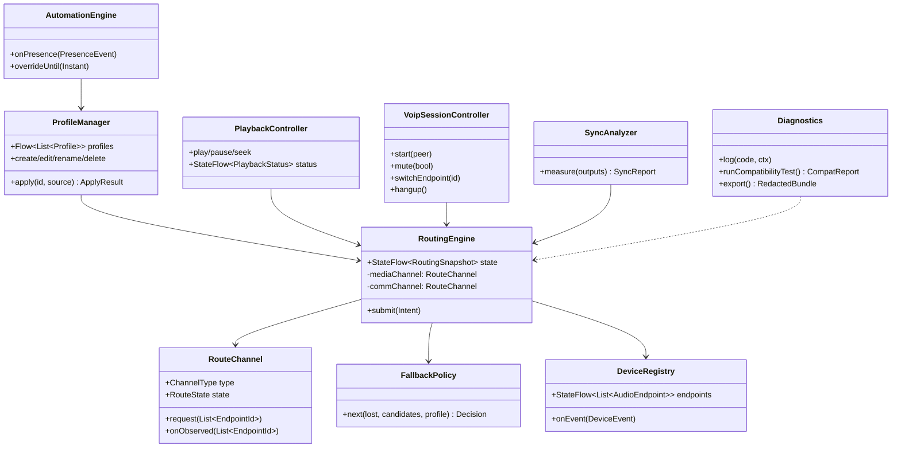
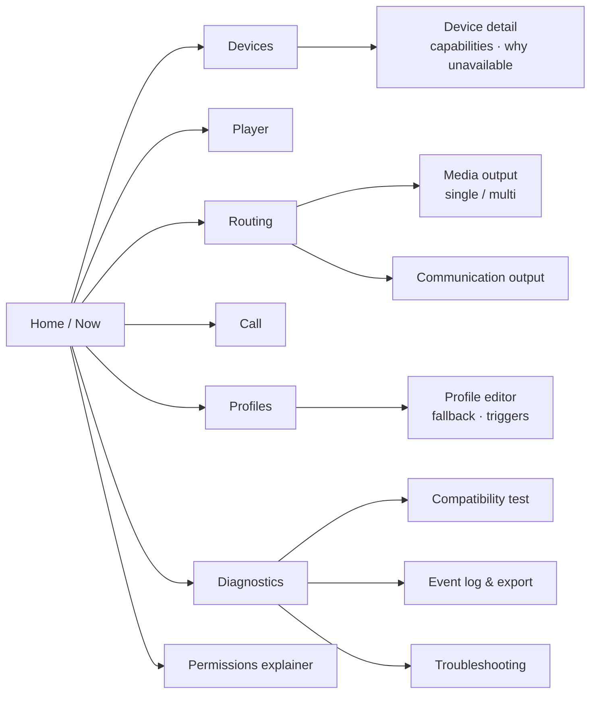

# Shared Core & Cross-Platform UI

**Status:** Draft v0.1 — 2026-10-27
**Stack:** Kotlin Multiplatform 2.2 · Compose Multiplatform 1.9 · Coroutines/Flow · Koin (DI) · Room KMP + DataStore · SKIE (Swift interop)
**Related:** [ADR-001](adr/ADR-001-cross-platform-stack.md) · [Routing engine](06-routing-engine.md) · [Data model](07-data-model.md)

---

## 1. Why this split

| Layer | Shared? | Rationale |
|-------|---------|-----------|
| UI screens, navigation, theming | ✔ Compose Multiplatform | Single UI prototype (Deliverable 3); Android stays on Jetpack Compose per SRS §4 |
| ViewModels / state holders | ✔ | Same state machines on both OSes |
| Routing engine, fallback, profiles, automation rules, diagnostics | ✔ | Business rules must behave identically (RTE-008 truthfulness) |
| Persistence | ✔ Room KMP / DataStore | NFR-005, CFG-007 |
| Audio routing, playback, VoIP, Bluetooth | ✘ native | Kotlin on Android, Swift on iOS — SRS §4 |
| iOS app shell, system pickers, App Intents | ✘ SwiftUI | SRS §4 requires Swift/SwiftUI native layer |

## 2. Shared core components



## 3. Dependency injection

> **POC implementation note (D3, D4 — manual composition root `PartyMusikCore` and Swift driver protocols instead of Koin/SKIE):** see [15-poc-implementation.md §5](15-poc-implementation.md#5-deviations-from-the-design-docs-decided-while-building).

```kotlin
// commonMain
val coreModule = module {
    single { DeviceRegistry(get<AudioDevicePort>(), get<BluetoothPort>()) }
    single { RoutingEngine(get(), get<MediaRoutingPort>(), get<CommRoutingPort>(), get<MultiOutputPort>(), FallbackPolicy()) }
    single { ProfileManager(get<ProfileRepository>(), get()) }
    single { AutomationEngine(get(), get<PresencePort>(), get<SettingsStore>()) }
    single { PlaybackController(get<PlaybackPort>(), get()) }
    single { VoipSessionController(get<VoipPort>(), get()) }
    single { SyncAnalyzer(get<MultiOutputPort>(), get<MicCapturePort>()) }
    single { Diagnostics(get<DiagnosticsRepository>(), get()) }
}

// androidMain
val platformModule = module {
    single<AudioDevicePort> { AndroidAudioDeviceAdapter(get(), get()) }
    single<MediaRoutingPort> { AndroidMediaRoutingAdapter(get(), get()) }
    // …
}

// iosMain — Swift implementations are passed in at startup
fun initKoin(ports: IosPorts) = startKoin {
    modules(coreModule, module {
        single<AudioDevicePort> { ports.audioDevice }
        single<MediaRoutingPort> { ports.mediaRouting }
        // …
    })
}
```

Swift side:

```swift
@main struct PartyMusikApp: App {
    init() {
        KoinKt.doInitKoin(ports: IosPorts(
            audioDevice: IOSAudioDeviceAdapter(),
            mediaRouting: IOSMediaRoutingAdapter(),
            commRouting: IOSCommRoutingAdapter(),
            multiOutput: IOSMultiOutputAdapter(),
            voip: IOSVoipAdapter(),
            bluetooth: IOSBluetoothAdapter(),
            systemAudio: IOSSystemAudioAdapter(),
            permissions: IOSPermissionAdapter(),
            presence: IOSPresenceAdapter(),
            micCapture: IOSMicCaptureAdapter()))
    }
    var body: some Scene { WindowGroup { ComposeView().ignoresSafeArea() } }
}
```

## 4. UI — information architecture



### 4.1 Screens

| Screen | Purpose | Key SRS |
|--------|---------|---------|
| **Home / Now** | Current media + comm route cards with *Requested / Active* badges, active profile, quick profile switch | MED-004, DIA-001, CFG-005 |
| **Devices** | All endpoints grouped: *Active*, *Available*, *Paired – not available*, *Other*. Capability chips. Pair new / reconnect buttons → OS flows | DEV-001..008 |
| **Device detail** | Type, codec/profile hints, sample rates, channels, capabilities, "Why can't I select this?" | DEV-002, DEV-007 |
| **Player** | Local library / test tones, play/pause/seek, per-output volume sliders in multi mode | MED-001, MED-003, MED-008 |
| **Routing** | Media: single select or multi-select with drag-to-prioritise. Comm: single select. "Open system output picker" | DEV-005, RTE-001..003, EXT-002 |
| **Call** | Loopback / LAN VoIP: dial, mute, hangup, route switcher, live comm route | VOIP-001..006 |
| **Profiles** | List of Music / Calls / Multi-Device / Custom; create, rename, duplicate, delete | CFG-001..005 |
| **Profile editor** | Media targets (ordered), comm target, fallback policy, triggers, override behaviour | CFG-002, CFG-004, CFG-006, CFG-008 |
| **Diagnostics** | Three columns: Requested · Available · Active per channel; event log; sync report | DIA-001, MED-007 |
| **Compatibility test** | Guided test of current phone + connected accessories; saves result to matrix | DIA-002 |
| **Permissions** | What each permission is for, current status, request / open settings | DIA-004, DIA-005, DEV-008 |
| **Help** | Troubleshooting articles keyed by error codes; third-party & cellular disclosures | DIA-007, EXT-003, CALL-003 |

### 4.2 Route status UI contract (RTE-008)

| Engine state | Badge | Colour token | Screen-reader text |
|--------------|-------|--------------|--------------------|
| `Idle` | — | — | "No route requested" |
| `Requested` | ⏳ Switching… | `onSurfaceVariant` | "{device}, requested, waiting for system confirmation" |
| `Confirmed` | ✓ Active | `primary` | "{device}, active" |
| `Rejected` | ⚠ Not available | `error` | "{device}, request rejected: {reason}. Double tap for help" |
| `Degraded` | ⚠ Lost — using {fallback} | `tertiary` | "{device} disconnected, playing on {fallback}" |
| `Paused` | ⏸ Waiting for {device} | `onSurfaceVariant` | "Paused until {device} reconnects" |

The UI never renders `Confirmed` styling from local intent alone — it binds only to `RouteChannel.state` emitted by the engine.

### 4.3 Wireframes (low-fi)

```
┌──────────────────────────────┐   ┌──────────────────────────────┐
│ PartyMusik        [⚙] [🔀]   │   │ ← Routing                    │
│ Profile: Multi-Device ▾      │   │ MEDIA            [single|multi]│
│ ┌──────────────────────────┐ │   │ ☰ ☑ JBL Charge 6   ✓ Active  │
│ │ MEDIA                    │ │   │ ☰ ☑ Sony XM5       ✓ Active  │
│ │ ✓ JBL Charge 6           │ │   │ ☰ ☐ Phone speaker            │
│ │ ✓ Sony XM5   +38 ms comp │ │   │ ☰ ☐ Car kit  ⓘ calls only    │
│ └──────────────────────────┘ │   │                              │
│ ┌──────────────────────────┐ │   │ COMMUNICATION                │
│ │ CALLS                    │ │   │ ◉ Galaxy Buds3   ⏳ Switching│
│ │ ⏳ Galaxy Buds3 (request) │ │   │ ○ Phone earpiece             │
│ └──────────────────────────┘ │   │                              │
│ ▶  Track 03  ━━━━●──── 2:14  │   │ [Open system output picker]  │
│ [Devices][Player][Call][Diag]│   │ ⓘ Other apps may not follow  │
└──────────────────────────────┘   └──────────────────────────────┘
```

## 5. State management pattern

- **Unidirectional data flow:** `Screen → Intent → StateHolder → Core → StateFlow<UiState> → Screen`.
- StateHolders are KMP `ViewModel`s (`androidx.lifecycle:lifecycle-viewmodel` multiplatform).
- Navigation: `androidx.navigation:navigation-compose` multiplatform with type-safe routes.

```kotlin
class RoutingViewModel(private val engine: RoutingEngine, private val registry: DeviceRegistry) : ViewModel() {
    val ui: StateFlow<RoutingUi> = combine(engine.state, registry.endpoints) { s, eps ->
        RoutingUi(
            media = s.media.toUi(eps),
            comm  = s.comm.toUi(eps),
            multiAllowed = eps.count { Capability.MULTI_OUTPUT_MEMBER in it.capabilities } >= 2,
        )
    }.stateIn(viewModelScope, SharingStarted.WhileSubscribed(5_000), RoutingUi.Empty)

    fun selectMedia(ids: List<EndpointId>) = engine.submit(Intent.RequestMedia(ids, Source.USER))
    fun selectComm(id: EndpointId)         = engine.submit(Intent.RequestComm(id, Source.USER))
}
```

## 6. Accessibility & UX rules (NFR-007)

- Every interactive element ≥ 48 dp; contrast ≥ 4.5:1; Dynamic Type / font scale up to 200 %.
- Route state conveyed by **icon + text + colour**, never colour alone.
- Live region announcements (`LiveRegionMode.Polite`) on route confirmation / rejection.
- Errors always include *what happened*, *why (if known)*, *what to do next* and a help link.
