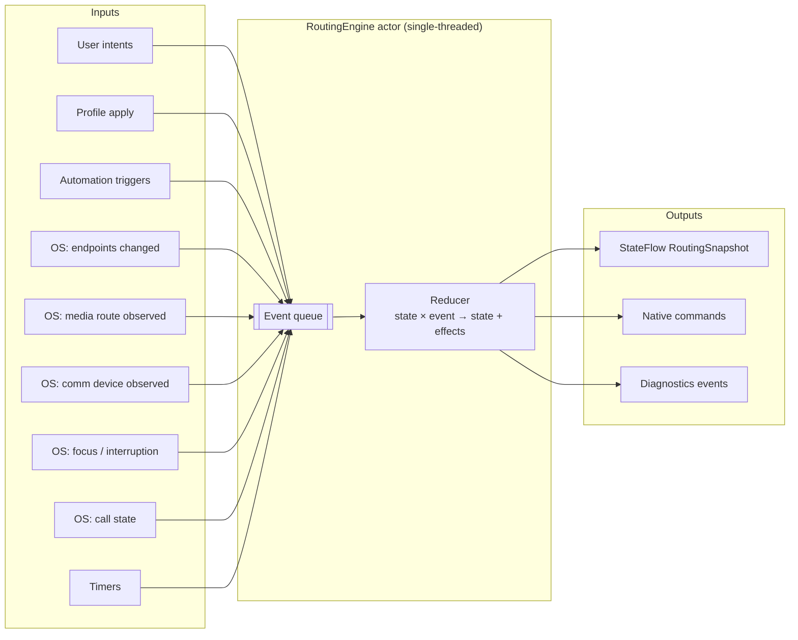
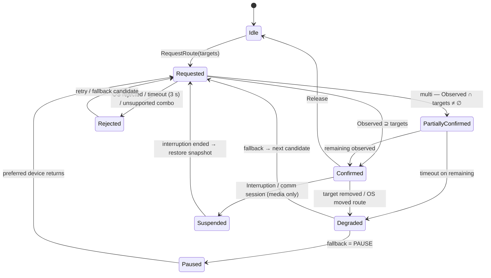
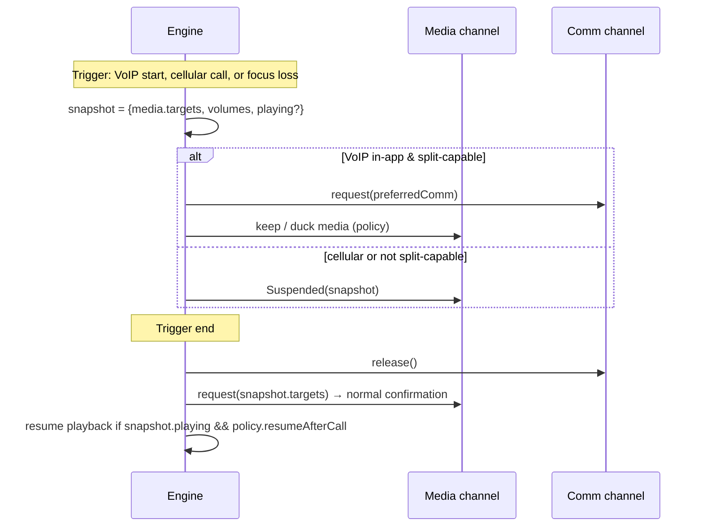

# Routing Engine Design

**Status:** Draft v0.1 — 2026-10-27
**Module:** `shared/src/commonMain/kotlin/engine`
**Related:** [ADR-003 route confirmation](adr/ADR-003-route-confirmation-model.md) · [Data model](07-data-model.md) · [Bridge API](08-native-bridge-api.md)

---

## 1. Responsibilities

1. Hold the authoritative **RoutingSnapshot**: for each channel (`MEDIA`, `COMMUNICATION`) the *requested*, *available* and *active* sets.
2. Turn intents (user, profile, automation, fallback) into native commands.
3. Promote a request to **Confirmed** only when the OS reports a matching active route (RTE-004, RTE-008, NFR-002).
4. Detect loss/mismatch and apply the **fallback policy** (MED-006, CFG-004).
5. Snapshot and restore preferences around communication sessions and interruptions (RTE-006, RTE-007).
6. Emit diagnostics for every transition (DIA-001, DIA-003).

## 2. Inputs and outputs



The reducer is a **pure function** `(State, Event) -> (State, List<Effect>)`, making it fully unit-testable with no platform code (see [10-test-strategy.md](10-test-strategy.md)).

```kotlin
class RoutingEngine(
    private val registry: DeviceRegistry,
    private val media: MediaRoutingPort,
    private val comm: CommRoutingPort,
    private val multi: MultiOutputPort,
    private val fallback: FallbackPolicy,
    private val clock: Clock = Clock.System,
    scope: CoroutineScope,
) {
    private val events = Channel<EngineEvent>(Channel.UNLIMITED)
    private val _state = MutableStateFlow(RoutingSnapshot.Initial)
    val state: StateFlow<RoutingSnapshot> = _state

    init {
        scope.launch(Dispatchers.Default.limitedParallelism(1)) {
            for (e in events) {
                val (next, effects) = reduce(_state.value, e, clock.now())
                _state.value = next
                effects.forEach { run(it) }
            }
        }
        scope.launch { registry.endpoints.collect { events.send(EngineEvent.EndpointsChanged(it)) } }
        scope.launch { media.observedRoute.collect { events.send(EngineEvent.MediaObserved(it)) } }
        scope.launch { comm.observed.collect { events.send(EngineEvent.CommObserved(it)) } }
    }

    fun submit(intent: Intent) { events.trySend(EngineEvent.FromIntent(intent)) }
}
```

## 3. Channel state machine

> **POC implementation note (D5 — `Degraded` is represented by `Confirmed`/`Requested` carrying `FallbackInfo`; D7/D8 refine fallback):** see [15-poc-implementation.md §5](15-poc-implementation.md#5-deviations-from-the-design-docs-decided-while-building).



| State | Meaning | UI |
|-------|---------|----|
| `Idle` | Nothing requested | — |
| `Requested(targets, since)` | Command sent; awaiting OS | "Switching…" |
| `PartiallyConfirmed(confirmed, pending)` | Multi-output: some outputs live | Per-output badges |
| `Confirmed(active)` | OS reports the targets as active | "Active" |
| `Rejected(targets, error)` | Could not route | Error + help |
| `Degraded(lost, current)` | Was confirmed, lost one or more outputs | "Lost — using X" |
| `Paused(waitingFor)` | Playback paused per policy | "Waiting for X" |
| `Suspended(snapshot, reason)` | Media yielded to call / interruption | "Paused for call" |

**Confirmation rules**

- Single output: `Confirmed` iff `targets.single() ∈ observed`.
- Multi-output: each target is confirmed individually by its sink's routed-device callback (Android `AudioRouting.OnRoutingChangedListener`, iOS `currentRoute.outputs` channel ownership).
- Confirmation timeout: **3 s** default (configurable; BT SCO setup can need ~1.5 s).
- If the OS reports a *different* device than requested → `Rejected(OsRedirected(actual))` — the UI shows *where audio actually is*.

## 4. Fallback policy (MED-006, CFG-004)

```kotlin
sealed interface FallbackRule {
    data object NextInPriority : FallbackRule          // walk the profile's ordered list
    data object BuiltInSpeaker : FallbackRule
    data object LastKnownGood : FallbackRule
    data object Pause : FallbackRule                   // pause until preferred returns
    data object StopMultiKeepRest : FallbackRule       // multi: drop lost output, keep others
    data class  Specific(val id: EndpointId) : FallbackRule
}

data class FallbackPolicyConfig(
    val rules: List<FallbackRule> = listOf(FallbackRule.StopMultiKeepRest, FallbackRule.NextInPriority, FallbackRule.Pause),
    val autoResumeWhenPreferredReturns: Boolean = true,
    val resumeWindow: Duration = 10.minutes,
    val avoidEarpieceForMedia: Boolean = true,
)
```

Evaluation: rules are tried in order; the first rule that yields an *available and capable* endpoint wins. Every decision is logged as `FALLBACK_APPLIED{rule, from, to}`.

## 5. Communication sessions & interruptions (RTE-006, RTE-007, VOIP-005)



## 6. Priority & arbitration between sources

| Source | Priority | Notes |
|--------|----------|-------|
| `USER` (manual) | 4 (highest) | Sets a **manual override** that blocks automation until cleared or until `overrideUntil` (CFG-008) |
| `FALLBACK` | 3 | Only acts on loss / rejection |
| `PROFILE` (manual apply) | 2 | |
| `AUTOMATION` | 1 | Ignored while manual override active |

## 7. Multi-output orchestration

1. Validate set: each target has `MULTI_OUTPUT_MEMBER`; combination checked against compatibility DB (`declared`, `untested`, `known-bad`). Unknown combos are allowed and marked *experimental* (NFR-010 messaging).
2. `multi.start(targets)`; channel enters `Requested`.
3. Per-sink routed callbacks drive `PartiallyConfirmed → Confirmed`.
4. If `profile.autoSync` → `SyncAnalyzer.measure()` → `multi.setDelay()` per output so all align to the slowest.
5. Loss of one output → `StopMultiKeepRest` default.

### Sync analyzer (MED-007)

- Emits a 20 ms linear chirp (2–8 kHz) on output *k* at scheduled host time *T*.
- Records via mic (`.measurement` mode / `UNPROCESSED` source), cross-correlates to find arrival time *A_k*.
- `latency_k = A_k − T − micLatency`; offsets `Δ_k = max(latency) − latency_k`.
- Repeats 5×, reports median, IQR; stored as `SyncReport`. Also logs OS-reported latencies (`AudioTrack.getTimestamp`, `AVAudioSession.outputLatency`) for comparison.

## 8. Error codes

| Code | Raised when | User message key | Help article |
|------|-------------|------------------|--------------|
| `RTE_TIMEOUT` | No confirmation within window | `err_route_timeout` | `help/route-timeout` |
| `RTE_OS_REDIRECTED` | OS active ≠ requested | `err_route_redirected` | `help/os-chose-other` |
| `RTE_DEVICE_GONE` | Target not in registry | `err_device_gone` | `help/device-disconnected` |
| `RTE_NOT_COMM_CAPABLE` | Comm request to A2DP-only | `err_not_comm` | `help/calls-vs-media` |
| `RTE_UNSUPPORTED_COMBO` | Multi combo known-bad | `err_combo` | `help/multi-output` |
| `RTE_SESSION_CONFLICT` | iOS session arbitration denied | `err_session_conflict` | `help/other-app-audio` |
| `BT_OFF` | Bluetooth disabled | `err_bt_off` | `help/enable-bt` |
| `PERM_BT_DENIED` / `PERM_MIC_DENIED` | Permission missing | `err_perm_*` | `help/permissions` |
| `MEDIA_SERVICES_RESET` | iOS media server reset | `err_media_reset` | — (auto recover) |

## 9. Invariants (enforced by property tests)

1. `Confirmed.active ⊆ lastObserved` — never confirmed without observation.
2. At most one in-flight command per channel; a new request supersedes the old one (generation counter).
3. Events from a superseded generation are ignored for confirmation but still update *Active* display.
4. Release always clears comm device (no leaked `setCommunicationDevice`).
5. Reducer is total: every `(state, event)` pair returns a valid state (no exceptions → NFR-001).
