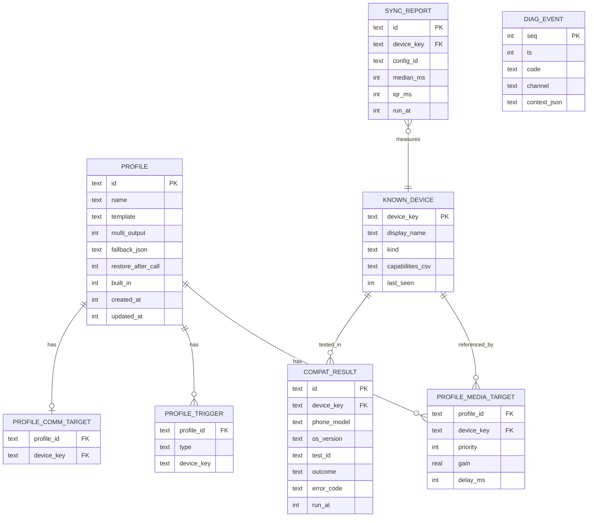

# Data Model & Persistence

**Status:** Draft v0.1 — 2026-10-27
**Related:** [ADR-002 local persistence](adr/ADR-002-local-persistence.md) · [Security & privacy](12-security-privacy.md)

---

## 1. Domain types (commonMain)

```kotlin
@JvmInline value class EndpointId(val value: String)   // "android:<type>:<hash(address)>" | "ios:<portUID>"

enum class EndpointKind {
    BUILTIN_SPEAKER, BUILTIN_EARPIECE, WIRED, USB, HDMI,
    BT_CLASSIC_MEDIA, BT_CLASSIC_HFP, BT_LE_AUDIO, BT_LE_BROADCAST,
    HEARING_AID, AIRPLAY, CAR_AUDIO, OTHER
}

enum class ConnectionState { CONNECTED, CONNECTING, PAIRED_NOT_CONNECTED, UNAVAILABLE }

data class AudioEndpoint(
    val id: EndpointId,
    val stableKey: String,                 // hashed BT address / port UID, survives reconnects
    val name: String,
    val kind: EndpointKind,
    val connection: ConnectionState,
    val capabilities: Set<Capability>,
    val sampleRates: List<Int> = emptyList(),
    val channelCounts: List<Int> = emptyList(),
    val unavailableReason: UnavailableReason? = null,   // DEV-007
)

enum class UnavailableReason { NOT_CONNECTED, CALLS_ONLY, NOT_AUDIO_DEVICE, BT_OFF, PERMISSION, UNSUPPORTED }

enum class ChannelType { MEDIA, COMMUNICATION }

sealed interface RouteState { /* Idle, Requested, PartiallyConfirmed, Confirmed, Rejected, Degraded, Paused, Suspended */ }

data class ChannelSnapshot(
    val type: ChannelType,
    val requested: List<EndpointId>,       // DIA-001 column 1
    val available: List<EndpointId>,       // DIA-001 column 2
    val active: List<EndpointId>,          // DIA-001 column 3 — OS observed only
    val state: RouteState,
    val generation: Long,
)

data class RoutingSnapshot(val media: ChannelSnapshot, val comm: ChannelSnapshot, val override: ManualOverride?)
```

## 2. Profiles (CFG-001..008)

```kotlin
data class Profile(
    val id: String,                         // UUID
    val name: String,
    val template: ProfileTemplate,          // MUSIC, CALLS, MULTI_DEVICE, CUSTOM
    val mediaTargets: List<DeviceRef>,      // ordered priority (DEV-005)
    val multiOutput: Boolean,
    val perDeviceGain: Map<String, Float>,  // stableKey → 0..1 (MED-008)
    val perDeviceDelayMs: Map<String, Int>, // from last SyncReport
    val commTarget: DeviceRef?,
    val fallback: FallbackPolicyConfig,
    val triggers: List<Trigger>,
    val restoreAfterCall: Boolean = true,
    val createdAt: Instant,
    val updatedAt: Instant,
    val builtIn: Boolean,                   // built-ins can be edited but not deleted
)

data class DeviceRef(val stableKey: String, val displayName: String, val kind: EndpointKind)

sealed interface Trigger {
    data class DeviceConnected(val device: DeviceRef) : Trigger
    data class DeviceDisconnected(val device: DeviceRef) : Trigger
    data object VoipCallStarted : Trigger
    data object AppLaunched : Trigger
}

data class ManualOverride(val profileId: String?, val until: Instant?)   // CFG-008
```

### Built-in templates (CFG-003)

| Template | Media | Comm | Multi | Fallback |
|----------|-------|------|-------|----------|
| **Music** | Best available A2DP/LE → wired → speaker | Follow media | ✘ | NextInPriority → Pause |
| **Calls** | Unchanged | Preferred headset → earpiece | ✘ | NextInPriority → BuiltIn |
| **Multi-Device** | All `MULTI_OUTPUT_MEMBER` selected, auto-sync on | Built-in earpiece | ✔ | StopMultiKeepRest → NextInPriority |
| **Custom** | User-defined | User-defined | User | User |

## 3. Storage schema (Room KMP)

> **POC implementation note (D2 — the POC stores profiles and settings as one JSON document via `LocalStore`; this schema is the production target):** see [15-poc-implementation.md §5](15-poc-implementation.md#5-deviations-from-the-design-docs-decided-while-building).



## 4. Settings (DataStore, `settings.preferences_pb`)

| Key | Type | Default |
|-----|------|---------|
| `active_profile_id` | String | `builtin-music` |
| `manual_override_until` | Long? | null |
| `confirm_timeout_ms` | Int | 3000 |
| `automation_enabled` | Boolean | true |
| `diagnostics_retention_days` | Int | 7 |
| `onboarding_done` | Boolean | false |
| `experimental_combos_enabled` | Boolean | false |
| `crash_reporting_opt_in` | Boolean | false |

## 5. Retention & encryption

> **POC implementation note (doc 15 D2, D9):** the POC encrypts its single JSON store instead: Android `EncryptedFileTextStore` (AES-256-GCM, key generated in and never leaving the Android Keystore), iOS data protection `CompleteUntilFirstUserAuthentication` so locked-phone Shortcuts automations can still read profiles.

| Data | Retention | Protection |
|------|-----------|------------|
| Profiles, known devices | Until deleted | Android: SQLCipher-backed Room (key in Android Keystore); iOS: `NSFileProtectionComplete` + key in Keychain |
| Diagnostics events | Ring buffer, 7 days / 5 000 events | Same DB, redacted at write time |
| Sync reports, compat results | 90 days | Same DB |
| Audio samples (sync test) | **Never persisted** — processed in memory | — |

## 6. Migration policy

- Room `AutoMigration` for additive changes; manual `Migration` objects for renames.
- Schema JSON exported to `shared/schemas/` and checked in CI.
- Profile export/import format: versioned JSON (`schemaVersion: 1`) for user backup (no cloud).
