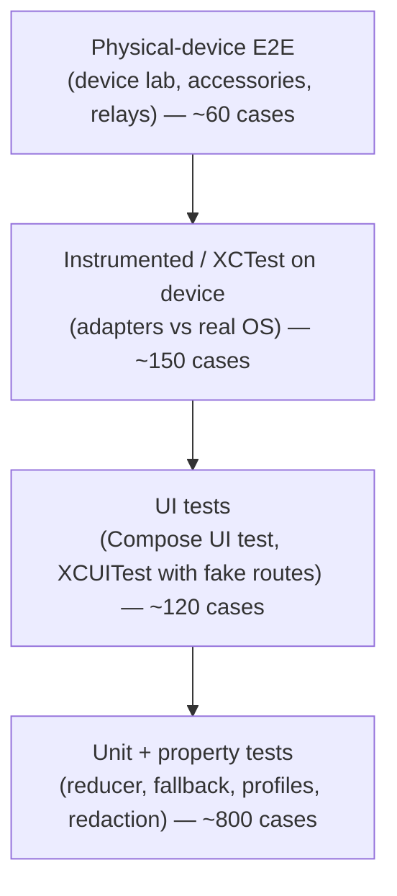
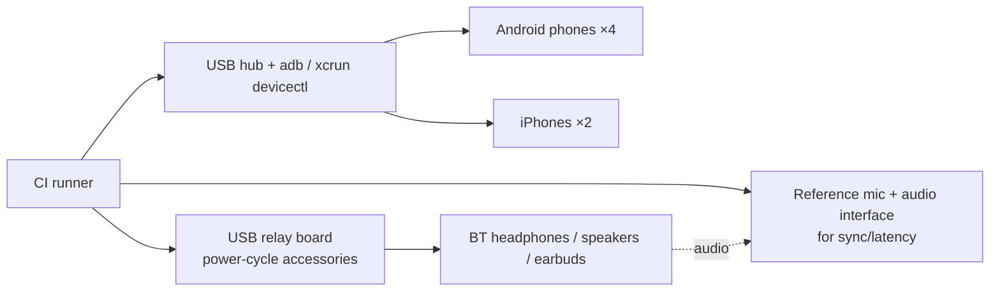

# Test Strategy

**SRS deliverable:** #5 (automated and physical-device test suites)
**Status:** Draft v0.1 — 2026-10-27
**Related:** [Compatibility matrix](11-compatibility-matrix.md) · [Traceability](13-requirements-traceability.md)

---

## 1. Test pyramid

| Level | Tooling | Runs on | Trigger |
|-------|---------|---------|---------|
| Unit (commonTest) | kotlin.test, Turbine, Kotest property | JVM + iOS simulator | Every PR |
| Adapter unit | JUnit + Robolectric / XCTest with `FakeAudioSession` | JVM / simulator | Every PR |
| UI | Compose Multiplatform UI test, XCUITest | Emulator / simulator | Every PR |
| Instrumented | AndroidX Test, XCTest | Firebase Test Lab / real devices | Nightly |
| Physical E2E | Custom harness + USB relay board + BT accessory rig | In-house device lab | Nightly + release |
| Soak / stress | Harness loops | Device lab | Weekly + release |

## 2. Unit & property tests (shared core)

| Area | Examples |
|------|----------|
| Reducer | Every `(state, event)` pair returns a valid state; superseded generations ignored |
| Truthfulness (RTE-008) | Property: for random event sequences, `Confirmed.active ⊆ lastObserved` always |
| Fallback | Each rule × each loss scenario; `StopMultiKeepRest` keeps survivors |
| Interruptions | VoIP start/end restores snapshot (RTE-006); cellular call suspends media |
| Profiles | CRUD, rename collisions, built-in delete forbidden, persistence round-trip (CFG-001, CFG-007) |
| Automation | Trigger match, manual override blocks automation until expiry (CFG-008) |
| Redaction | Diagnostics never contain raw MAC, names hashed when export option set (DIA-003) |
| Sync analyzer | Synthetic chirp with known offsets → measured within ±1 ms |

## 3. Physical-device test lab

- Accessories are power-cycled via relays to simulate disconnects (MED-005, NFR-001).
- A reference measurement mic in an acoustic box records outputs for sync (MED-007) and "audio actually comes out of X" verification (RTE-004).
- `dumpsys audio`, `dumpsys bluetooth_manager`, iOS `sysdiagnose` audio logs captured on failure.

## 4. Physical test catalogue (excerpt)

| ID | Scenario | Steps | Pass criteria | SRS |
|----|----------|-------|---------------|-----|
| PT-01 | Enumerate | Connect 3 accessories | All appear with correct kind/caps within 1 s | DEV-001/002, AC1 |
| PT-02 | Paired, off | Power off paired headphones | Shown as "Paired · not connected" with reason | DEV-007 |
| PT-03 | BT disabled | Toggle BT off | Banner + enable action; no crash | DEV-008 |
| PT-04 | Media select | Choose speaker → headphones | Ref-mic detects audio on headphones; UI "Active" only after OS confirms | MED-001, RTE-004, AC3, AC8 |
| PT-05 | Rejected route | Request HFP-only car kit for media | Actionable error `RTE_NOT_*` + help link | RTE-005, AC6 |
| PT-06 | Split routing | Media on speaker, VoIP on earbuds | Both routes confirmed; ref-mic confirms both | RTE-003, VOIP-006, AC4 |
| PT-07 | Restore after call | End VoIP | Media route restored to pre-call state | RTE-006 |
| PT-08 | Cellular interruption | Place call to test SIM | Media suspends, resumes after; routes shown read-only | RTE-007, CALL-001 |
| PT-09 | Multi-output | Each declared config M1–M6 | Audio on all outputs; skew report generated | MED-002, MED-007, AC5 |
| PT-10 | Per-device volume | Adjust sliders in multi | Ref-mic level delta matches | MED-008 |
| PT-11 | Disconnect during play | Relay power-off target | No crash; fallback per policy within 1 s | MED-005/006, AC7 |
| PT-12 | Automation | Power-on known device with app killed | Profile applied (Android) / via Shortcut (iOS) | CFG-006 |
| PT-13 | Manual override | Override, then trigger automation | Automation ignored until override expiry | CFG-008 |
| PT-14 | Restart persistence | Kill app, relaunch | Profiles and active profile restored | CFG-007, AC2 |
| PT-15 | Compatibility test | Run DIA-002 wizard | Report generated, matches matrix | DIA-002 |
| PT-16 | Permissions | Deny mic, deny BT | Features degrade gracefully, explainer shown | DIA-004/005, AC10 |
| PT-17 | System picker | Open output switcher from app | System UI shown; third-party disclosure visible | EXT-002/003, AC9 |

## 5. Stress & soak (NFR-001, NFR-003)

| ID | Scenario | Volume | Pass |
|----|----------|--------|------|
| ST-01 | Connect/disconnect cycling | 200 cycles per accessory | 0 crashes, 0 ANRs, state correct after each |
| ST-02 | Rapid route switching | 500 switches, 200 ms apart | No stuck `Requested` > timeout |
| ST-03 | BT toggle storm | BT on/off 100× | Engine recovers |
| ST-04 | iOS media services reset | Trigger via Settings dev option | Full recovery, routes re-observed |
| ST-05 | 4-hour playback multi-output | Continuous | No drift > 20 ms after compensation; memory flat |

## 6. Performance targets (NFR-003, NFR-004)

| Metric | Target | How measured |
|--------|--------|--------------|
| Device-list update after connect | < 500 ms | Event timestamp vs. relay switch |
| Route switch (A2DP → A2DP) audible gap | < 1.5 s | Ref-mic silence detection |
| Request → Confirmed (media) | < 1 s p95 | Engine diagnostics |
| Request → Confirmed (comm/SCO) | < 2 s p95 | Engine diagnostics |
| Idle battery drain (app backgrounded, no playback) | < 0.5 %/h | Battery Historian / Xcode Energy Log |
| Playback overhead vs. reference player | < 10 % extra | Same |
| Cold start | < 1.5 s | Macrobenchmark / XCTest metrics |

## 7. Accessibility (NFR-007)

- Automated: Compose `semantics` assertions; Android Accessibility Test Framework; XCTest `performAccessibilityAudit()`.
- Manual: TalkBack and VoiceOver walk-through of every screen per release.

## 8. Privacy & security tests (NFR-006, DIA-003, DIA-006)

- Static check: no `AudioPlaybackCapture`, no ReplayKit, no network calls in release build except opt-in crash reporting.
- DB file inspected on rooted/jailbroken test device: encrypted at rest.
- Diagnostics export scanned for MAC/address patterns, names (when anonymised option on), audio data.

## 9. Exit criteria per release

1. All unit/UI tests green; coverage ≥ 80 % on `shared/engine` and `shared/automation`.
2. All physical tests pass on every **declared** configuration in the compatibility matrix.
3. Stress suite: 0 crashes.
4. Acceptance criteria AC1–AC10 each linked to ≥ 1 passing test ([traceability](13-requirements-traceability.md)).
