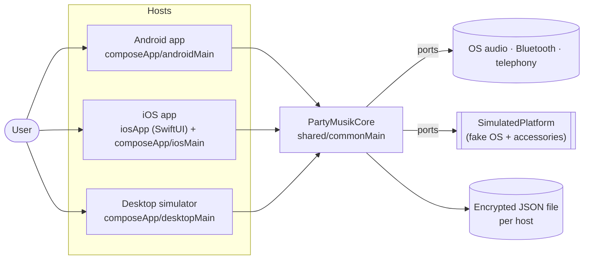
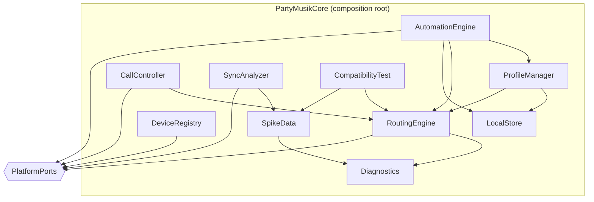
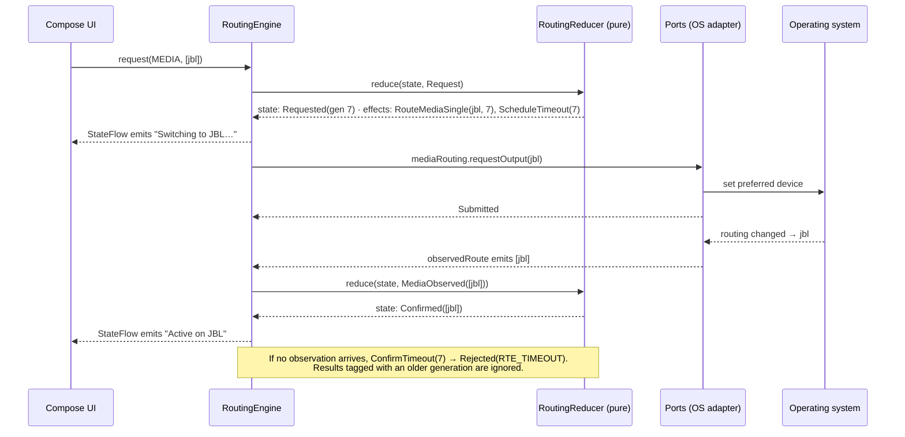
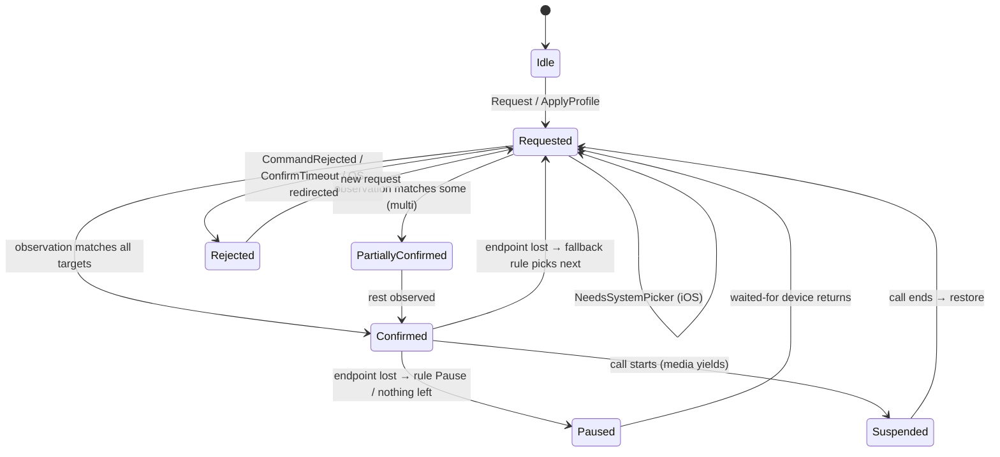
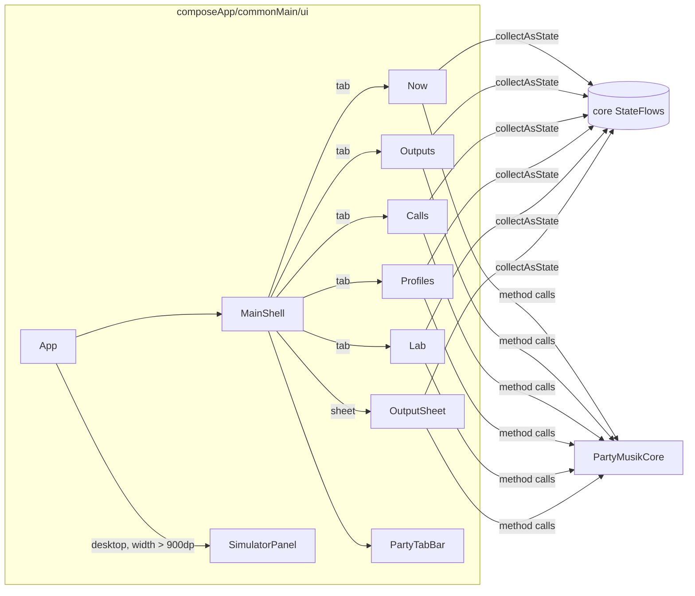

# As-Built Architecture

**Status:** v0.2 — 2026-10-30 · describes the code in this repository, not the design intent
**Related:** [02 System architecture](02-system-architecture.md) (design intent) · [15 POC implementation](15-poc-implementation.md) (deviations D1–D10) · [18 UI views & redesign](18-ui-views-and-redesign.md)

[02](02-system-architecture.md) and [05](05-shared-core-and-ui.md) were written before the code. This document is drawn from the code as it stands and is the one to trust when they disagree. §8 lists every place they do.

---

## 1. One-paragraph summary

PartyMusik is a Kotlin Multiplatform app with three hosts — Android, iOS and a desktop simulator — sharing one core and one Compose Multiplatform UI. Each host builds a `PlatformPorts` bundle (12 port interfaces plus `PlatformInfo`) and a `TextStore`, then hands them to `PartyMusikCore`, the composition root. Inside the core a single-threaded **routing engine** runs a pure reducer over `EngineEvent`s and emits `Effect`s that call back out through the ports. Route state reaches `Confirmed` only when the OS reports it through an observation flow (ADR-003). The UI collects the core's `StateFlow`s directly and calls core methods; there is no ViewModel layer.

## 2. Context



| Host | Entry point | Ports from | Store |
|------|-------------|------------|-------|
| Android | `PartyMusikApplication.onCreate` (process-wide, so `CompanionDeviceService` wake-ups hit the same engine) | `AndroidPlatform` (`shared/androidMain/android/`) | `EncryptedFileTextStore` (Keystore AES-GCM) |
| iOS | `PartyMusikApp.swift` → `MainViewController(core)` | `IosPlatform` (Kotlin) wrapping Swift **driver protocols** (`AppDrivers`, `AudioController`, `CallController`, `SystemServices`) | file with iOS data protection |
| Desktop | `desktop/Main.kt` | `SimulatedPlatform` | `FileTextStore` in `~/.partymusik-sim` |

## 3. Modules and packages

```
PartyMusik/
├── shared/                                  KMP library: android · iosX64/Arm64/SimArm64 · jvm
│   └── src/
│       ├── commonMain/kotlin/io/mahajan/partymusik/
│       │   ├── PartyMusikCore.kt            composition root
│       │   ├── domain/                      Endpoints, Routing (RouteState, RouteError), Profiles
│       │   ├── engine/                      RoutingEngine (actor) · RoutingReducer (pure) · EngineModel · ProfileResolver
│       │   ├── ports/                       Ports.kt — 12 port interfaces + PlatformPorts bundle
│       │   ├── registry/                    DeviceRegistry — classifies endpoints vs bonded devices
│       │   ├── profiles/                    ProfileManager — CRUD + apply
│       │   ├── automation/                  AutomationEngine — presence-triggered profiles
│       │   ├── calls/                       CallController — VoIP + cellular observation
│       │   ├── sync/                        SyncAnalyzer — chirp cross-correlation, compensation
│       │   ├── diagnostics/                 Diagnostics log · CompatibilityTest · SpikeData · Troubleshooting
│       │   ├── data/                        LocalStore — one JSON document behind TextStore
│       │   ├── platform/                    expect/actual clock, TextStore, ExportSink
│       │   └── simulation/                  SimulatedPlatform — fake OS used by desktop + tests
│       ├── androidMain/…/android/           AudioManager, AudioTrack engine, Core-Telecom, CDM adapters
│       ├── iosMain/…/ios/                   IosDrivers (protocols Swift implements) · IosPlatform
│       ├── jvmMain/                         actuals for the desktop
│       └── commonTest/                      41 tests: reducer, integration, sync, diagnostics, spike data
├── composeApp/                              Compose Multiplatform app
│   └── src/
│       ├── commonMain/…/ui/                 App (5-tab shell, UiSession), SimulatorPanel
│       │   ├── theme/                       PartyTheme (tokens, light/dark), PartyIcons (line icons, no dependency)
│       │   ├── components/                  RouteStatus (routeLabel + glyphs), Layout, Controls, Artwork
│       │   └── screens/                     Now, OutputSheet, Outputs, Calls, Profiles (+ editor sheet), Lab
│       ├── androidMain/                     MainActivity, PartyMusikApplication, PlaybackService, PresenceService
│       ├── iosMain/                         MainViewController
│       └── desktopMain/                     Main.kt
└── iosApp/                                  XcodeGen project: SwiftUI host, AVAudioSession/CallKit drivers, App Intents
```

**Dependency rule:** `ui → core (commonMain) → ports ← adapters`. Nothing in `commonMain` imports a platform API; adapters depend on `ports` and `domain` only. `simulation/` lives in `commonMain` so tests on every target can use it.

## 4. Core components



| Component | Responsibility | Publishes |
|-----------|----------------|-----------|
| `RoutingEngine` | Serialises every routing event through one `Channel`, runs `RoutingReducer.reduce`, executes the returned effects against ports | `state: StateFlow<RoutingSnapshot>` |
| `RoutingReducer` | Pure, total function `(RoutingSnapshot, EngineEvent, now) → Transition(state, effects)`. Holds every routing rule: generations, fallback, call suspension, override | — |
| `DeviceRegistry` | Combines adapter state, endpoints and bonded devices into "connected outputs" vs "paired, not available + why" | `inventory: StateFlow<DeviceInventory>` |
| `ProfileManager` | Profile CRUD, built-in profiles, `apply()` → `EngineEvent.ApplyProfile` | `profiles: StateFlow<List<Profile>>` |
| `AutomationEngine` | Diff presence events → fire matching profile with `RequestSource.AUTOMATION`; respects manual override | — |
| `CallController` | Starts/ends VoIP via `VoipPort`, maps cellular state into `CommSessionStarted/Ended` | `callState`, `muted` |
| `SyncAnalyzer` | Plays a chirp per output via `SyncProbePort`, cross-correlates, computes per-output delay | `SyncReport` (returned) |
| `CompatibilityTest` | Tries every output for media, calls and multi; records what the OS confirmed | `CompatReport` (returned, streamed via callback) |
| `Diagnostics` | Ring-buffered event log with salted device-name hashing for export | `events` |
| `LocalStore` | Profiles + `AppSettings` in one JSON doc, mutex-guarded writes | `profiles`, `settings` |

## 5. The routing engine

### 5.1 Event loop



### 5.2 Invariants (enforced in `RoutingReducer`, covered by `RoutingReducerTest`)

1. A channel is `Confirmed` only for endpoints in the latest OS observation (RTE-008).
2. Every request bumps the channel's `generation`; late results from older generations are dropped.
3. Ending a VoIP session always releases the communication device (VOIP-005).
4. `reduce` never throws; the engine still wraps it and logs `ENGINE_REDUCER_ERROR` as a last line of defence.

### 5.3 Route state



Fallback is not a separate state: `Confirmed` and `Requested` carry `FallbackInfo(lost, original)` so the UI can say "Active on Phone speaker · Sony lost" and the reducer can restore the original when it returns (deviation D5).

### 5.4 Request priority

`RequestSource`: `AUTOMATION(1) < PROFILE(2) < FALLBACK(3) < USER(4)`. A `USER` request sets a `ManualOverride` (default 2 h, `RoutingPolicy.overrideDurationMs`); while it is active the `AutomationEngine` does not fire. The Home screen shows the override and a "Resume automations" button that dispatches `ClearOverride`.

## 6. Ports (bridge API)

All in `ports/Ports.kt`. Command methods return `RouteCommandResult` (`Submitted | NeedsSystemPicker | Rejected`) and never mean "active"; observation flows are the only source of truth.

| Port | Commands | Observations |
|------|----------|--------------|
| `AudioDevicePort` | — | `endpoints` |
| `MediaRoutingPort` | `requestOutput`, `clearPreference` | `observedRoute` |
| `CommRoutingPort` | `request`, `release` | `observed` |
| `MultiOutputPort` | `start`, `stop`, `setDelay`, `setGain` | `observedRoutes` |
| `PlaybackPort` | `load`, `play`, `pause`, `seekTo` | `status`, `library` |
| `VoipPort` | `startCall`, `hangup`, `setMuted` | `callState`, `muted` |
| `CallObserverPort` | — | `cellularCall` |
| `BluetoothPort` | `requestEnable`, `launchPairing`, `launchReconnect` | `adapterState`, `bonded` |
| `SystemAudioPort` | `showSystemOutputPicker`, `openSystemSettings` | `audioSharing` |
| `PermissionPort` | `request`, `openAppSettings` | `statuses` |
| `PresencePort` | `observe`, `stopObserving` | `presence` |
| `SyncProbePort` | `probe` (play + record in one call) | — |
| `PlatformInfo` | — | `os`, `model`, `supportsSplitMediaAndComm`, `supportsMultiOutput` |

On iOS, Swift does not implement these directly: it implements small callback **driver** protocols in `IosDrivers.kt`, and Kotlin's `IosPlatform` turns them into Flow-based ports (deviation D4).

## 7. UI layer



- **State binding:** each screen calls `collectAsState()` on `core.engine.state`, `core.registry.inventory`, `core.profiles.profiles`, `core.ports.playback.status`, `core.calls.callState`, etc.
- **Intents:** screens call core methods directly (`core.engine.request(...)`, `core.profiles.apply(...)`), launching suspend calls in `rememberCoroutineScope()`.
- **Navigation:** a `Tab` enum held in `UiSession`, five tabs in a bottom bar, and Material 3 `ModalBottomSheet`s for the output picker, device details, call audio and the profile editor. No navigation library.
- **`UiSession`:** UI-only state that must survive switching tabs: the selected tab, the open output sheet, per-output gain, the last sync report and the compatibility test run. Routing state never lives here.
- **Route-status contract:** `routeLabel()` in `components/RouteStatus.kt` is the only mapping from a channel's `RouteState` to text, colour, glyph and screen-reader text; `endpointGlyph()` derives the per-row glyph from the same channel snapshot. Only OS-confirmed routes get a round check.
- **Theme:** `PartyTheme` provides the docs/18 tokens through `LocalPartyColors` and maps them onto a Material 3 colour scheme so stock components (switches, sheets, dialogs) match.

See [18 UI views & redesign](18-ui-views-and-redesign.md) for the per-screen design and what changed from the spec.

## 8. Drift from the design docs

Deviations D1–D10 are already recorded in [15 §5](15-poc-implementation.md#5-deviations-from-the-design-docs-decided-while-building). These are the remaining places where [02](02-system-architecture.md) and [05](05-shared-core-and-ui.md) no longer match the code:

| Design doc says | Code has | Fix in doc |
|-----------------|----------|------------|
| 02 §6: packages `playback/`, `voip/` | No such packages; playback is a port (`PlaybackPort`), VoIP lives in `calls/` | Update 02 §6 tree |
| 02 §6: `tools/sync-harness/` | Not present | Remove or mark planned |
| 02 §6: `iosApp/PlatformIOS/` Swift package | Swift lives in `iosApp/iosApp/Platform/`, project generated by XcodeGen | Update path |
| 05 §5: KMP `ViewModel`s, `navigation-compose` with type-safe routes | No ViewModels; screens bind to core flows directly; `Tab` enum + bottom sheets | Mark as v1.0 target (see 18 §B.6 step 5) |
| 05 §4.1: 7+ screens incl. separate Device detail, Permissions and Help | 5 tabs (Now, Outputs, Calls, Profiles, Lab); device detail is a sheet; permissions and help live in Lab | Superseded by [18](18-ui-views-and-redesign.md) |
| 05 §4.2: `Degraded` badge | `Confirmed` + `FallbackInfo` (D5) | Update contract table |

## 9. Threading and lifecycle

- **Engine:** one coroutine draining an unlimited `Channel<EngineEvent>`, so state changes are serial. Effects that call ports launch their own coroutines and report back as events (`CommandRejected`, `SystemPickerRequired`, `ConfirmTimeout`).
- **Desktop:** the whole core and simulator share `Dispatchers.Default.limitedParallelism(1)`, which mirrors the single-threaded actor.
- **Android:** the core lives in the `Application`, outliving activities. `PlaybackService` (Media3 `MediaSessionService` around `PlaybackPortPlayer`) and `PresenceService` (`CompanionDeviceService`) reach it through the application.
- **Start-up:** `PartyMusikCore.start()` loads the store, starts the engine, calls and automation, ensures built-in profiles, waits up to 2 s for the first OS endpoint snapshot, then applies the saved profile.

## 10. Persistence and privacy

- `LocalStore` keeps profiles and `AppSettings` in a single JSON document behind `TextStore`, encrypted per platform (D2, D9).
- Diagnostics persist separately (`DiagnosticsPersistence`) and hash device names with a per-install salt when exported anonymised.
- Sync measurement audio is analysed in memory and never stored.
- No network, no backend, no analytics.

## 11. Testing

`./gradlew :shared:jvmTest` runs 41 tests against `SimulatedPlatform`: the reducer state machine (`RoutingReducerTest`), end-to-end core flows (`CoreIntegrationTest`), sync correlation, diagnostics redaction and spike CSV export. The UI has no automated tests; the desktop host with its simulator panel is the manual test bed. Compose Desktop's `ImageComposeScene` can render any screen to PNG headlessly against `SimulatedPlatform`, which is how the redesign was checked.
