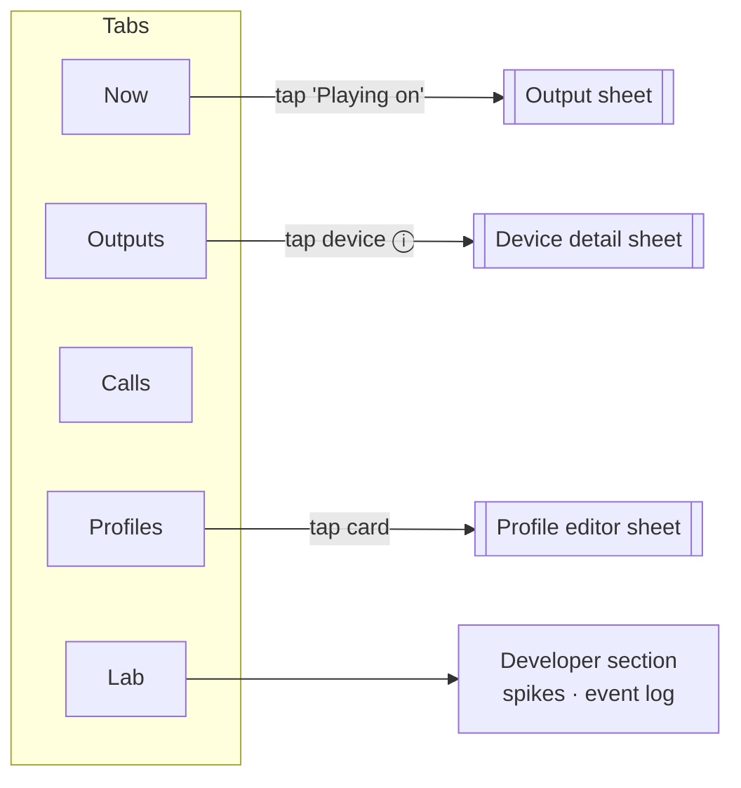

# UI Views & Redesign

**Status:** v0.2 — 2026-10-30 · implemented in the Compose UI (desktop verified; Android and iOS builds not yet run)
**Related:** [05 Shared core & UI](05-shared-core-and-ui.md) · [17 As-built architecture](17-as-built-architecture.md) · design canvas: [PartyMusik Redesign](https://claude.ai/artifact/VegWwzzJLyqZJk9imKpvPU) (private until shared)

Part A is an inventory of every view the Compose UI had before the redesign, taken from `composeApp/src/commonMain/kotlin/io/mahajan/partymusik/ui/`. Part B is a new design in an Apple-like style: calmer, more direct, and built around what the user is doing rather than around engine concepts.

---

# Part A — Current UI inventory

## A.1 Shell

| Element | Code | Notes |
|---------|------|-------|
| Root | `App(core, simulator?)` — `App.kt` | Wraps everything in `PartyMusikTheme` (Material 3, purple `#5B3FD1` / teal / amber, light + dark) |
| Scaffold | `MainScaffold` | `TopAppBar("PartyMusik")` + `ScrollableTabRow` with **7 tabs**. Selected tab held in `remember { mutableStateOf(Screen.HOME) }` |
| Simulator | `SimulatorPanel` | Desktop only, 360 dp column to the right when the window is wider than 900 dp |
| Screen body | `ScreenColumn` | Vertical scroll, 16 dp padding, 12 dp gaps; every screen is a stack of `SectionCard`s |

## A.2 Screens

| # | Tab | Sections (in order) | State it reads | Actions | SRS |
|---|-----|---------------------|----------------|---------|-----|
| 1 | **Now** (`HomeScreen`) | Profile chips + override notice · Media route card · Calls route card · Now playing (title, Play/Pause, time) · "Limits for other apps" disclosure | `engine.state`, `profiles.profiles`, `playback.status` | Apply profile · Resume automations · Play/Pause · "Change…" → Routing / Call | MED-004, DIA-001, CFG-005, CFG-008 |
| 2 | **Devices** (`DevicesScreen`) | Bluetooth-off banner · Nearby-devices permission banner · Connected outputs (name, kind, "Media/Calls active" tags, capability tags, "Use for media/calls") · Paired, not available (+ reason, Reconnect) · Pair new / System output picker · Audio-sharing note | `registry.inventory`, `engine.state`, `permissions.statuses`, `systemAudio.audioSharing` | Turn on BT · Allow · Use for media · Use for calls · Reconnect · Pair · Open picker | DEV-001..008 |
| 3 | **Routing** (`RoutingScreen`) | Media output: route badge, One/Multiple segmented, radio or checkbox list, "Play on N outputs" · Call output: radio list, Release · Other apps: system picker + disclosure | `engine.state` | Request media (single/multi) · Request/release comm · Open picker | DEV-005, RTE-001..005, MED-002 |
| 4 | **Player** (`PlayerScreen`) | Library (radio list of 3 items) · Now playing (title, route badge, seek slider, −10 s / Play / +10 s) · *Multi only:* Per-output volume sliders · Sync: Measure delay → per-output ms, skew, Apply compensation | `engine.state`, `playback.status`, local `gains`, `SyncReport` | Load+play · Seek · Gain per output · Measure · Apply compensation | MED-001..003, MED-007, MED-008 |
| 5 | **Call** (`CallScreen`) | In-app call (status text, Start test call / Hang up + Mute switch) · Call audio output (radio list, media note) · *Cellular only:* phone call card · Cellular disclosure | `engine.state`, `calls.callState`, `calls.muted` | Start call · Hang up · Mute · Switch output · Open sound settings | VOIP-001..006, CALL-001..003 |
| 6 | **Profiles** (`ProfilesScreen`) | Profile list (name, template tag, Active tag, summary, Apply/Edit/Duplicate/Delete) · New profile (name field, template radios, Create) | `profiles.profiles`, `engine.state` | Apply · Edit · Duplicate · Delete · Create | CFG-001..005 |
| 6a | ↳ **Profile editor** (`ProfileEditor`, replaces the list in place) | Name + multi-output + auto-sync switches · Media outputs in priority order (↑ ↓ Remove, + Add) · Call output radios + restore switch · Fallback rule checkboxes + auto-resume switch · Automation (device-connected checkboxes) · Save / Cancel | `engine.state.endpoints/knownRefs`, local draft | Edit all fields · Save (rename + save + sync presence) | CFG-002, CFG-004, CFG-006, CFG-008 |
| 7 | **Diagnostics** (`DiagnosticsScreen`) | Requested · Available · Active table per channel · Automation switch · Compatibility test (run, streamed ✓/✗ rows, totals) · Permissions (status + Allow / Open settings) · Help & limitations (expandable) · Spike measurements (p50/p95/max, Save CSV, Reset) · Event log (anonymise switch, Export dialog, Clear, monospace list) | `engine.state`, `store.settings`, `permissions.statuses`, `diagnostics.events`, `spikeData.*` | Toggle automation · Run test · Allow · Export · Clear · Save CSV · Reset | DIA-001..007 |
| — | **Simulator panel** (desktop) | Bluetooth switch · Accessory switches · Incoming phone call · OS behaviour toggles (ignore JBL, redirect, picker-only, Sony can't join multi) · Route switch delay slider · Mic permission | `SimulatedPlatform.*` | Drive the fake OS | — |

## A.3 Shared components (`Components.kt`)

| Component | Role |
|-----------|------|
| `SectionCard(title)` | Material `Card` + semibold heading (semantics `heading()`) |
| `Tag(text, color)` | 6 dp-radius label chip |
| `CapabilityTags(caps)` | `FlowRow` of `Tag`s |
| `routeLabel(state, s)` → `RouteLabel(text, spoken, color)` | **The route-status contract.** Only `Confirmed` says "Active" (RTE-008) |
| `RouteBadge(state, s)` | Renders `routeLabel`, polite live region |
| `Muted(text)` | `bodySmall`, `onSurfaceVariant` |
| `Banner`, `DisclosureCard`, `HelpItem`, `ChoiceRow`, `Toggle` | Screen-local helpers |

## A.4 What gets in the user's way

| # | Problem | Where |
|---|---------|-------|
| U1 | **Seven tabs in a scrolling tab row.** On a phone, Profiles and Diagnostics are off-screen and the main job (pick where music plays) is split across Now, Devices, Routing and Player. | `MainScaffold` |
| U2 | **The same choice in three places.** "Use for media" (Devices), radio list (Routing) and "Change…" (Now) all request the media route, each looking different. | Devices, Routing, Now |
| U3 | **Engine vocabulary on screen.** "Requested / Active (reported by system)", "generation 7", "comm", "multi-output member". Users think in "Playing on JBL". | Now, Diagnostics |
| U4 | **Status is text-only and colour-light.** `⏳ Switching…`, `✓ Active` are emoji + coloured text; nothing shows *which row* is switching. | `RouteBadge` |
| U5 | **Player is split from Now.** Now has Play/Pause and a timestamp; seek, library and volume live on another tab. | Now, Player |
| U6 | **Everything is a card.** Every section is the same `Card` with a title, so nothing stands out: the active route has the same weight as the disclosure. | All |
| U7 | **Editor replaces the list in place.** No sheet, no back gesture; Cancel is at the very bottom. | ProfilesScreen |
| U8 | **Developer tools mixed with user settings.** Spike CSVs and the event log sit next to permissions and help. | Diagnostics |

---

# Part B — Redesign

## B.1 Principles

1. **One question per screen.** *What's playing and where?* · *What can I play to?* · *Where does my call go?* · *Which setup?* · *Is it working?*
2. **Direct manipulation.** Tap the device to route to it. No intermediate "Change…" steps, no separate Routing screen.
3. **Truth stays visible, quietly.** The route-status contract (RTE-008) is kept exactly: a row never shows a checkmark until the OS confirms. Switching gets a spinner *on the row being switched*, not a sentence somewhere else.
4. **Depth, not cards.** Content sits on a grouped background; translucent materials for chrome (tab bar, sheets); one hero element per screen.
5. **Plain words.** "Playing on", "Together", "Waiting for Sony", not "requested", "multi", "comm".

## B.2 Information architecture

7 tabs → **5 tabs** in a bottom tab bar, plus sheets.

| Old | New |
|-----|-----|
| Now + Player | **Now** — artwork, transport, scrubber, library, "Playing on" chip, profile switcher |
| Devices + Routing (media) | **Outputs** — One / Together, device tiles, per-output volume, sync, unavailable devices |
| Call + Routing (call output) | **Calls** — call card, call-audio picker, cellular note |
| Profiles + editor | **Profiles** — mode cards; editor is a sheet |
| Diagnostics | **Lab** — health, route pipeline, compatibility test, permissions, help; spikes + log under *Developer* |

## B.3 Screens

### Now
- Large title "Now", profile switcher as a horizontal row of pills under it (tap = apply; active pill filled with accent).
- Override notice as a small inline pill: "Manual choice · automations paused 1 h 52 m · Resume".
- **Hero:** square artwork (geometric, generated from the track id), title, artist line, scrubber with elapsed/remaining, transport (−10 s · Play/Pause · +10 s) at 44–64 pt.
- **"Playing on" chip** under the transport: device glyphs + names + status glyph. Tap → **Output sheet**.
- "Up next" list = the library.
- Call-route mini row at the bottom: "Calls go to Sony WH-1000XM5 ✓".

### Output sheet (AirPlay-picker pattern)
- Half-height sheet on a translucent material, grab handle, title "Play on".
- One row per media-capable output: glyph, name, kind + latency, trailing status (empty circle · spinner · filled check · warning).
- Tapping a row in **One** mode routes immediately; in **Together** mode it toggles membership and a "Play on 2 outputs" button confirms.
- Footer: "Other apps use the system picker" → `showSystemOutputPicker()`.

### Outputs
- Segmented control **One · Together**.
- **Playing** group: device tiles (2-column), each with a large glyph, name, status, and in Together mode a capsule volume slider (app-side gain) and measured delay.
- **Sync** card (Together only): bars showing each output's delay against the slowest, skew number, **Align** (measure + apply in one step; the two raw steps stay in Lab).
- **Available** list, **Not available** list with reason in secondary text and a "Reconnect" button.
- Footer buttons: Pair new device · System output picker.
- Bluetooth-off / permission states replace the content with an empty state + one primary button instead of a red banner above it.

### Calls
- Idle: large round green "Start test call" button with "Echo test · loopback" caption.
- In call: peer name, timer, round **Mute** / **Audio** / **End** buttons (iOS call-screen layout).
- **Call audio** picker as a list with glyphs; status glyphs as in the output sheet.
- Media note: "Music pauses during the call and resumes after" or "Music keeps playing on JBL".
- Cellular state as an orange banner card: "Phone call · routed by your dialer".

### Profiles
- 2-column grid of mode cards (Focus-mode style): glyph on a tinted circle, name, one-line summary, "Active" check. Built-ins: Music (note), Calls (phone), Together (two speakers), Custom (slider).
- "+ New profile" card opens the editor sheet with a template picker.
- **Editor sheet:** grouped inset lists — Outputs (reorderable rows with drag handles), Play together + Align automatically, Calls, When an output disconnects (ordered rule list), Automation (device switches). Cancel / Done in the sheet header.

### Lab
- **Health** summary card: "All routes confirmed" / "1 issue" with the route pipeline per channel drawn as three steps: Requested → Available → Active.
- Compatibility test: progress ring + streamed results, pass/fail glyphs.
- Permissions list with status + action.
- Help & limitations: disclosure rows.
- **Developer** (collapsed by default): automation switch, spike measurements, event log + export.

## B.4 Design tokens

### Colour

| Token | Light | Dark | Use |
|-------|-------|------|-----|
| `bg.grouped` | `#F2F2F7` | `#000000` | Screen background |
| `bg.card` | `#FFFFFF` | `#1C1C1E` | Grouped rows, tiles |
| `bg.elevated` | `#FFFFFF` | `#2C2C2E` | Sheets |
| `material.chrome` | `rgba(249,249,249,0.78)` + blur 24 | `rgba(29,29,31,0.72)` + blur 24 | Tab bar, sheet header |
| `label` | `#000000` | `#FFFFFF` | Primary text |
| `label.secondary` | `#6C6C70` | `#98989F` | Secondary text (≥ 4.5:1 on cards) |
| `separator` | `#C6C6C8` | `#38383A` | Hairlines |
| `accent` | `#5B3FD1` | `#A895FF` | Brand violet (kept from the current theme), selection, confirmed |
| `status.pending` | `label.secondary` | `label.secondary` | Spinner, "Switching…" |
| `status.warn` | `#B25000` | `#FF9F0A` | Partly active, fallback, picker needed, cellular |
| `status.error` | `#D70015` | `#FF453A` | Rejected |
| `call.go` / `call.end` | `#248A3D` / `#D70015` | `#30D158` / `#FF453A` | Call buttons only |

Status colours always come with a distinct glyph *and* text (§B.5), so colour is never the only signal, and violet/orange differ in lightness as well as hue.

### Type (SF Pro on iOS; system sans on Android and desktop)

| Style | Size / line | Weight |
|-------|-------------|--------|
| Large title | 34 / 41 | Bold |
| Title 2 | 22 / 28 | Bold |
| Headline | 17 / 22 | Semibold |
| Body | 17 / 22 | Regular |
| Subhead | 15 / 20 | Regular |
| Footnote | 13 / 18 | Regular |
| Caption | 12 / 16 | Medium |

Supports font scale to 200 %; layouts reflow, nothing is fixed-height except artwork.

### Shape, space, motion

- Spacing on a 4 pt grid: 4 · 8 · 12 · 16 · 20 · 24 · 32. Screen gutter 16; group gap 24.
- Radius: hero artwork 24 · tiles and groups 20 · buttons 14 · pills full.
- Touch targets ≥ 44 pt (48 dp on Android).
- Motion: one spring (response 0.35 s, damping 0.85) for sheets, tiles and selection. Route status morphs spinner → check in 250 ms. Under *Reduce motion*: cross-fade only.

## B.5 Route-status contract (unchanged semantics, new visuals)

| `RouteState` | Row glyph | Text | Colour | Spoken |
|--------------|-----------|------|--------|--------|
| `Idle` | empty circle | — | separator | "Not selected" |
| `Requested` | spinner | "Switching…" | pending | "{device}, switching, waiting for system confirmation" |
| `Requested(needsSystemPicker)` | arrow-out | "Choose in system picker" | warn | "{device} requested, confirm in the system output picker" |
| `PartiallyConfirmed` | half-filled circle | "Waiting for {pending}" | warn | "Partly active on {confirmed}, waiting for {pending}" |
| `Confirmed` | filled check | "Playing" | accent | "{device}, active" |
| `Confirmed + fallback` | filled check + small warn dot | "Playing · {lost} disconnected" | accent + warn | "{lost} disconnected, playing on {device}" |
| `Rejected` | triangle | error message | error | "{device}, request rejected: {message}" |
| `Paused` | pause | "Waiting for {device}" | pending | "Paused until {device} reconnects" |
| `Suspended` | pause | "Paused for call" | pending | "Media paused during the call" |

`routeLabel()` stays the single mapping; it gains a `glyph` field. Nothing renders a check from local intent.

## B.6 Implementing it in Compose

| Step | Change | Files |
|------|--------|-------|
| 1 | Tokens: replace the Material colour scheme with `PartyColors` (light/dark), `PartyType`, `PartyShapes`; expose through `CompositionLocal`s. Keep `MaterialTheme` underneath for components we still use. | `Components.kt` → new `theme/` |
| 2 | Shell: bottom tab bar with a translucent background (`Modifier.background(alpha) + blur` on Android 12+, plain fill fallback), 5 destinations. Use `navigation-compose` multiplatform so sheets and back gestures work. | `App.kt` |
| 3 | Components: `InsetGroup`, `GroupRow`, `RouteGlyph(state)`, `DeviceTile`, `CapsuleSlider`, `PillSwitcher`, `ModeCard`, `RoundCallButton`, `Artwork(seed)`. | new `ui/components/` |
| 4 | Screens: `NowScreen` (merge Home+Player), `OutputsScreen` (merge Devices+Routing media), `CallsScreen`, `ProfilesScreen` + `ProfileEditorSheet` (`ModalBottomSheet`), `LabScreen`. | `ui/screens/` |
| 5 | Optional: introduce thin state holders per screen (05 §5) so previews and UI tests don't need a full `PartyMusikCore`. | `ui/screens/*State.kt` |

No core or port changes are needed. iOS can keep the Compose UI; a later step could wrap the tab bar and sheets in native SwiftUI for real Liquid Glass materials.

## B.6.1 As built (2026-10-30)

Steps 1–4 are done; step 5 (state holders) is not. Code: `composeApp/src/commonMain/kotlin/io/mahajan/partymusik/ui/` → `theme/`, `components/`, `screens/`, `App.kt`.

Where the build differs from the spec above:

| Spec | Built | Why |
|------|-------|-----|
| `navigation-compose` for sheets and back | `Tab` enum in `UiSession` + Material 3 `ModalBottomSheet` | Avoids a new dependency; sheets already handle back/swipe-to-dismiss |
| Translucent tab bar with blur | Near-opaque chrome fill, no blur | Compose has no backdrop blur; at lower opacity, text scrolling underneath clashed with the tab labels |
| Drag handles to reorder outputs | Up / down / remove buttons per row | Works with keyboard and screen readers without a custom drag-and-drop |
| Profile card tap opens the editor | Tap applies the profile; **Edit** opens the editor sheet | Applying is the frequent action |
| Lab keeps raw "measure" and "apply" steps | **Align** in Outputs measures and applies in one step; results stay visible | One button; the measured figures are shown, so nothing is hidden |
| Automation switch under Lab › Developer | Moved to Profiles › Automations | It controls profiles |
| — | Selection in "Together" and in rule lists uses square boxes | Round checks are reserved for OS-confirmed routes (§B.5) |
| — | Classic-Bluetooth outputs without a mic are drawn as speakers | The OS reports headsets and speakers as the same kind |
| — | Device detail sheet (from Outputs) keeps "Use for calls" and capability chips | Carries over DEV-002 / DEV-007 from the old Devices screen |

## B.7 Accessibility checks for the redesign

- Every status = glyph + text + colour; live region on the status text (as today).
- Text contrast ≥ 4.5:1 in both themes, including secondary labels on cards.
- Device tiles and mode cards are single buttons with full labels ("JBL Charge 6, playing, volume 80 percent").
- Capsule sliders expose `progressBarRangeInfo` and step by 5 %.
- Sheet focus moves to its title; Escape / back closes.
