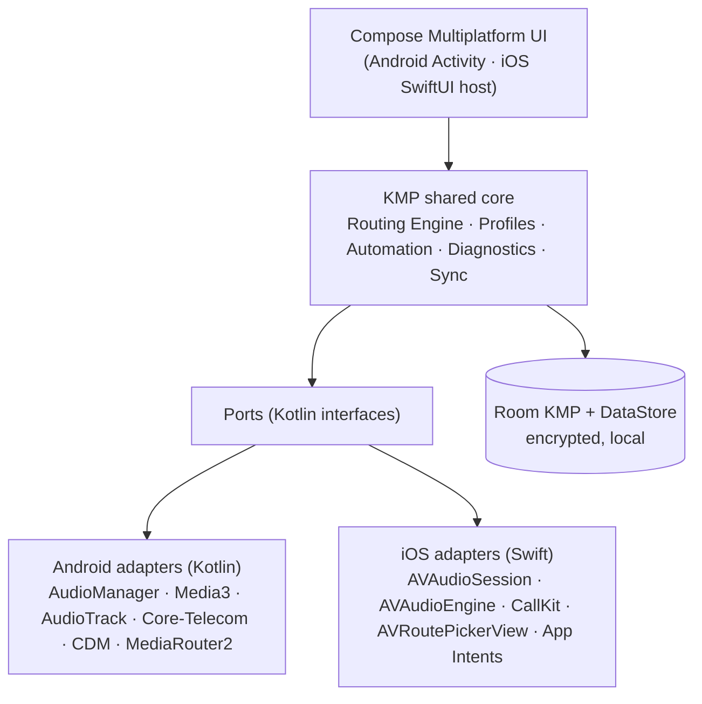

# PartyMusik — Multi-Device Bluetooth Audio Manager

Documentation set for the POC and the v1.0 build of the Multi-Device Bluetooth Audio Manager (Android + iOS).

## Start here

| If you are… | Read |
|-------------|------|
| New to the project | [00 SRS](00-srs.md) → [01 POC plan](01-poc-plan.md) → [02 System architecture](02-system-architecture.md) → [15 POC implementation](15-poc-implementation.md) |
| Android engineer | [03 Android architecture](03-android-architecture.md), [08 Bridge API](08-native-bridge-api.md) |
| iOS engineer | [04 iOS architecture](04-ios-architecture.md), [08 Bridge API](08-native-bridge-api.md) |
| KMP / UI engineer | [17 As-built architecture](17-as-built-architecture.md), [18 UI views & redesign](18-ui-views-and-redesign.md), [05 Shared core & UI](05-shared-core-and-ui.md), [06 Routing engine](06-routing-engine.md), [07 Data model](07-data-model.md) |
| QA | [16 Spike runbook](16-spike-runbook.md), [10 Test strategy](10-test-strategy.md), [11 Compatibility matrix](11-compatibility-matrix.md) |
| PM / stakeholder | [01 POC plan](01-poc-plan.md), [09 Feasibility report](09-feasibility-report.md), [13 Traceability](13-requirements-traceability.md) |

## Index

| # | Document | SRS deliverable |
|---|----------|-----------------|
| 00 | [Software Requirements Specification](00-srs.md) | Baseline |
| 01 | [POC plan](01-poc-plan.md): goals, 18 spikes, timeline, team, device lab, go/no-go | #2 |
| 02 | [System architecture](02-system-architecture.md): C4 views, layering, runtime flows, modules | #4 |
| 03 | [Android architecture & native POC](03-android-architecture.md) | #2, #4 |
| 04 | [iOS architecture & native POC](04-ios-architecture.md) | #2, #4 |
| 05 | [Shared core & cross-platform UI](05-shared-core-and-ui.md) | #3 |
| 06 | [Routing engine](06-routing-engine.md): state machine, fallback, sync analyzer, error codes | #2 |
| 07 | [Data model & persistence](07-data-model.md) | #4 |
| 08 | [Native bridge API (ports)](08-native-bridge-api.md) | #2 |
| 09 | [Platform feasibility report](09-feasibility-report.md) | #1 |
| 10 | [Test strategy](10-test-strategy.md) | #5 |
| 11 | [Compatibility matrix](11-compatibility-matrix.md) | #6 |
| 12 | [Security & privacy](12-security-privacy.md) | — |
| 13 | [Requirements traceability](13-requirements-traceability.md) | — |
| 14 | [Build, CI/CD & deployment](14-build-and-deployment.md) | #7 |
| 15 | [POC implementation](15-poc-implementation.md): what was built, how to run it, verification status, design deviations | #2, #3 |
| 16 | [Spike runbook](16-spike-runbook.md): device-lab procedure per spike, CSV exports, how results flow into 09 and 11 | #1, #4, #6 |
| 17 | [As-built architecture](17-as-built-architecture.md): the code as it stands — modules, engine loop, ports, UI binding, drift from 02/05 | #4 |
| 18 | [UI views & redesign](18-ui-views-and-redesign.md): inventory of every current view, UX issues, Apple-style redesign spec and tokens | #3 |

### Architecture decision records

| ADR | Decision |
|-----|----------|
| [ADR-001](adr/ADR-001-cross-platform-stack.md) | Kotlin Multiplatform + Compose Multiplatform, native audio adapters |
| [ADR-002](adr/ADR-002-local-persistence.md) | Room KMP + DataStore, encrypted at rest |
| [ADR-003](adr/ADR-003-route-confirmation-model.md) | Requested / Available / Active model, OS-only confirmation |
| [ADR-004](adr/ADR-004-automation-triggers.md) | Automation via CDM presence (Android) and Shortcuts + App Intents (iOS) |

## Architecture at a glance

## Conventions

- Requirement IDs (e.g. `RTE-008`) refer to [00-srs.md](00-srs.md).
- Spike IDs `S-xx` are defined in [01-poc-plan.md §4](01-poc-plan.md#4-spike-catalogue).
- Test IDs `PT-xx` / `ST-xx` are defined in [10-test-strategy.md](10-test-strategy.md).
- Diagrams use Mermaid and render on GitHub, GitLab, and in VS Code with a Mermaid extension.
